<h1 align="center">KensaiApp</h1>

<p align="center">runs on Claude Code · lives in your git repo · <b>You set the goal. The roles walk to it.</b></p>

<p align="center">


</p>

### A software factory of AI roles, held to a goal you wrote down.

1. **Finish line:** what done means for your product.
2. **Route:** the route to the finish line is not fixed. It is planned while it is walked.
3. **Pipeline:** each step is done by a different role, and checked by another.
4. **Software engineering:** the code is written to software engineering's best practices and methods.

KensaiApp is built and maintained by one contributor, [eyalgo](https://github.com/eyalgo).

KensaiApp runs a product's work the way a team of roles would: a PM, a product owner, an architect,
a tech lead, a developer, a senior engineer, an auditor. Each is its own agent run, with one job and
only the context that job needs. **A program, not a model, decides what runs next**, and every step
leaves a file in git. You write the goal once. The roles take it from there, and come back to you
only for the calls that are yours.

<p align="center">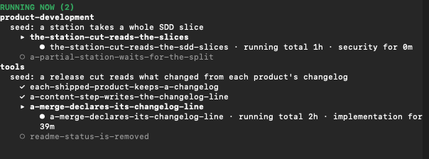</p>

<p align="center"><b>KensaiApp builds itself.</b> <sub>Two of its own projects walking at once, 2026-11-03. A real session.</sub></p>

---

**You bring the idea. KensaiApp develops it.** You write the product's definition and its finish line.
KensaiApp starts there. Through a pipeline of roles, each requirement is written, tested, audited and
merged. The work is proved against what was written down, not against what the code happens to do.
It walks products with no code too: a site, a CV, a stream of posts.

**You come back to sealed changes, not a chat log.** Each change carries its trail: the request,
the spec, the design, the plan, the tests, the integrity report, the audit. Read any of it, at any
time, in git.

## Software factory

**Prompting is for one change. A finish line is for a product.** Write down what done means, once.
The Principal PM cuts it into *seeds*, each a path through the product that leaves something working,
the riskiest first. The PM walks one seed at a time, station by station, and every station is built
in changes. After every change the PM reviews the route, and the route moves. The finish line does
not.

<details>
<summary>See it: one seed's route, five days apart</summary>
<br>
<table>
<tr>
<td valign="top" align="center"><sub>2026-10-28</sub><br>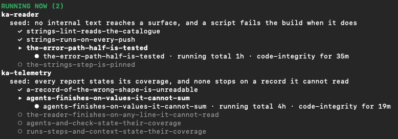</td>
<td valign="top" align="center"><sub>2026-11-02</sub><br>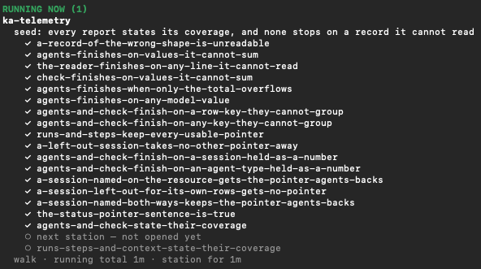</td>
</tr>
</table>
<sub>One seed of ka-telemetry, a project being built with KensaiApp. Its route grew from five stations to nineteen as the PM's review after each change added the work that change left. A real session.</sub>
</details>

### Coding standards and practices

Quality and security come first. When the Principal PM orders the seeds and the PM picks the next
one, work that makes the product sounder goes ahead of the next feature.

- **The developer** writes a failing test first, then the code that passes it, then the refactor. A
  task that skips its failing test halts the walk. It works from the sources it was given, not from
  memory, and it does not say done until it has run the check that proves it.
- **Engineering rules per language.** Every developer run reads KensaiApp's developer standards and
  the rules packet for the product's language. Packets ship for Python, TypeScript, JavaScript,
  Rust, Swift and shell.
- **The senior engineer** proves the change against the spec, not against itself. It adds the tests
  nobody wrote, and fixes the code where a correct test fails.
- **Security.** After the proof, the senior engineer runs the product's dependency audit, reads the
  change for holes, fixes what its rules allow and reports the rest to the PM. A first iteration.
- **The auditor** reviews how well each step did its job. What it finds goes to the PM's review of
  the route, and to the improvement of the skills themselves.

### Finish line and the route

The goal is written before the code. The route is decided while it is walked.
The Principal PM reviews the seeds every time a seed is retired, when its loop is closed.
The PM refines the stations every time a *change* is finished.
**A program sequences the work; a model never chooses what runs
next.** What the model must not bend is held by code: hooks, a commit check and the launchers. When
an AI decision and a mechanical rule disagree, the rule wins.

<details>
<summary>See it: a change dropped, and the station walked again</summary>
<br>
<p align="center">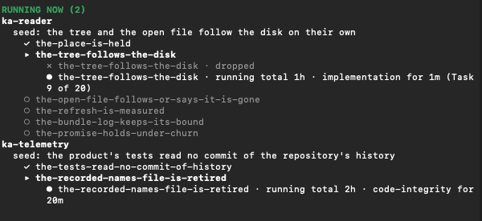</p>
<sub>The first change for a station was dropped, and the station is being built again by a new one. A real session, 2026-11-05.</sub>
</details>

### The concept in a few points (vibe coding)

1. Ask KensaiApp to create a project.
2. When it is done, tell it to *build idea*, or to *walk* it.
3. First it writes the product's documents (SDD, CONTENT and more). It stops to ask you only when it must.
4. Once the product's documents are settled, it builds the product slice after slice (*seed*, *station*, *change*).
5. Each walk is made of steps, and each step is done by its own role.

### A few commands to walk the journey and reach the finish line

Ask the session to *build idea* for your project.
You can also ask it to *walk* the journey, or to make one *change*.

```text
> build idea for my-app

  build-idea started for my-app, in the background. Its queue has three rows: open the next
  station, walk its change, refine the route. The panel shows where it is. I'll tell you when
  it stops, or if it needs you.
```

<sub>An example of the shape of a session, not a transcript.</sub>

You can also run a command in the terminal.

```bash
core/launchers/build-idea/launcher.sh <project>
```

### See the walk

Your runs work in the background. You watch them in a pane beside your Claude Code session.

- **Waiting on you:** only your calls, each with the act it needs.
- **Running now:** every project's route as a tree, the step each change is on, and for how long.
- **Notifications:** a run can message you when it ends, through a notifier you set up.

<details>
<summary>See it: two projects waiting on their owner</summary>
<br>
<p align="center">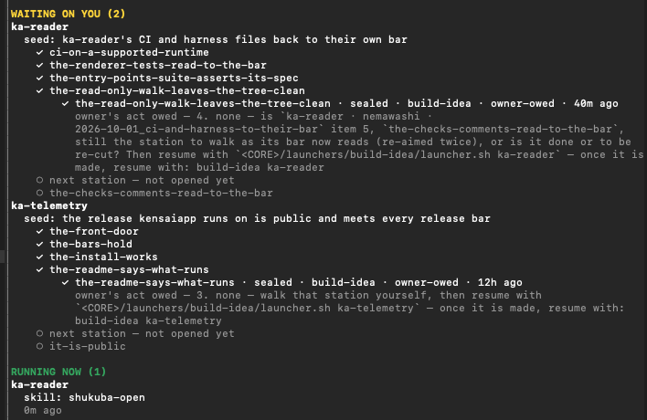</p>
<sub>ka-reader and ka-telemetry are projects being built with KensaiApp. A real session, 2026-10-22.</sub>
</details>

<details>
<summary>See it: two projects walking at once</summary>
<br>
<p align="center">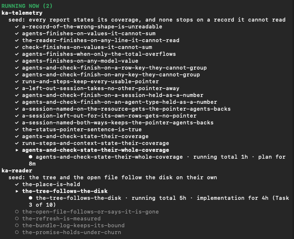</p>
<sub>Each on its own seed, with the step and the task each change is on. A real session, 2026-11-03.</sub>
</details>

<details>
<summary>See it: on your phone</summary>
<br>
<p align="center">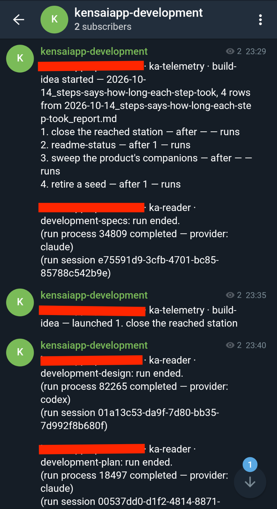</p>
<sub>Runs reporting their ends to a Telegram channel. A real session.</sub>
</details>

### CHANGELOG, README and what is left

Every change keeps the product's record up to date as it goes, so it never falls behind the code. A
product's state is read from two files.

- **README.** Once a product's documents are settled, KensaiApp writes the product's README from
  them, and it points at the two files below. It is not rewritten after each change: run
  `product-card` again when the README has fallen behind.
- **CHANGELOG.** Right after the build, a step of its own writes the change's entry: what changed for
  someone who clones and uses the product. A change only its developers see, such as one that only
  adds tests, gets none.
- **What is left.** Each product has one list of what its finish line and PRD want that the code does
  not do yet. A revised PRD or finish line adds to it, and the same step takes off what the change
  wholly builds. When nothing is left, it says so.

### One instance, several projects

An instance is one git repository. It holds several projects, each building its own product, and
they can walk at the same time. Everything in the instance is shared by its projects: the roles, the
rules they follow, and the *experience*, what every product in it may look like and sound like.
Set it once, and every product follows it.

<details>
<summary>See it: three projects of one instance, walking at once</summary>
<br>
<p align="center">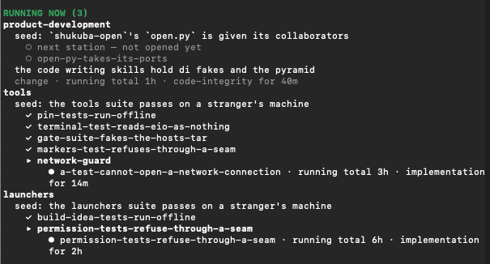</p>
<sub>Three of KensaiApp's own projects, in one instance. A real session, 2026-11-04.</sub>
</details>

**For the advanced:** you can run several instances, each with its own experience, rules and
projects. A *satellite* is an instance that reads the shared core of another, its host, so a change
to the core reaches every satellite at once. KensaiApp itself is built that way.

### Key concepts

Seven words. Everything else is built on them.

- **Instance.** One git repository with one long-term direction. It holds several projects.
- **Satellite.** An instance with no core of its own. It reads its host's.
- **Project.** One product, in the instance or in a repository of its own, with code or without.
- **Finish line.** What done means for the product, after its PRD. It judges every move.
- **Seed.** A path through the product that leaves something working. Cut from the documents.
- **Station.** One stop on a seed's route. Reached when its own done holds.
- **Change.** One unit of work, built on its own branch in its own worktree, sealed onto `main`.

The journey's words also have Japanese names, Nemawashi, Shukuba and Tobiishi. The
[architecture overview](about/architecture.md) says why.

## Get started

You need Claude Code, git and [uv](https://docs.astral.sh/uv/getting-started/installation/). uv
brings the Python KensaiApp runs on, so you do not install Python yourself.

### Installation

```bash
brew install uv          # or: curl -LsSf https://astral.sh/uv/install.sh | sh
git clone https://github.com/eyalgo/kensaiapp.git
cd kensaiapp
cp .providers.toml.example .providers.toml
```

Open Claude Code in the clone. The first session switches on KensaiApp's commit hooks. If the clone
already has hooks of its own, they are kept, and KensaiApp's commit check then runs only in runs a
launcher starts.

To run KensaiApp's own tests, uv brings the test tools too. What they need and what to expect is
[How to run KensaiApp's own tests](about/how-to.md#how-to-run-kensaiapps-own-tests).

```bash
uv run --locked pytest core/tools/ core/launchers/
```

### Set the instance experience

The experience says what every product in the instance may and may not look like and sound like: a
visual half and a voice half. KensaiApp comes with defaults, so you can start without touching it.

To make it your own, run the two skills that write it, the visual half first:

```bash
core/launchers/skill/launcher.sh experience-visual
core/launchers/skill/launcher.sh experience-voice
```

Neither asks you anything while it runs. What it cannot settle, it leaves as open questions beside
the files. To build products with a different experience, put them in another instance, such as a
satellite, with its own.

### Your first project

```
/add-dir skills/interactive-product
/project-setup
```

One plain-language conversation turns your idea into a project: its name, what kind it is, and
anything you have to start from, such as notes, documents, a design, old code and more. It then starts
the run that writes the project's PRD and its finish line. It has worked when both are written, with
any open questions in a companion file beside each.

<p align="center"><a href="about/images/getting-started.mp4">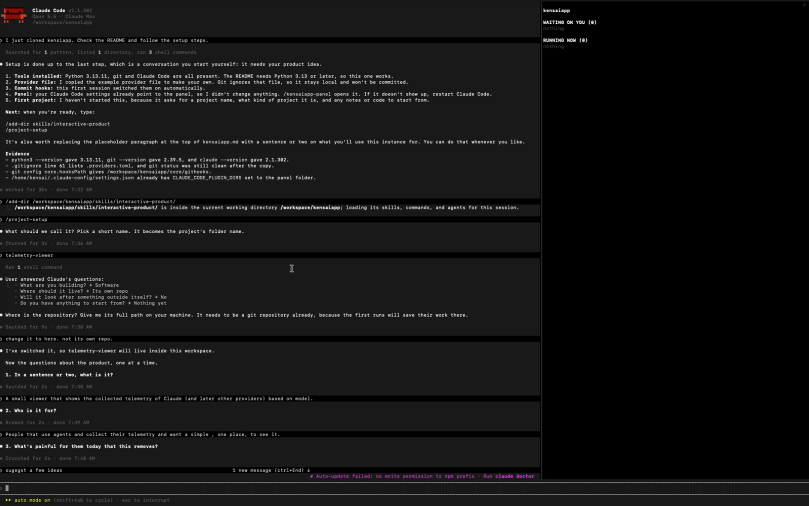</a></p>
<p align="center"><a href="about/images/getting-started.mp4"><b>▶ Watch a fresh clone set up, 48 seconds</b></a></p>

Then tell the session to start *build idea*, or to *walk* it.

You can also run it unattended from the terminal.

```bash
core/launchers/walk/launcher.sh <project>
```

#### How much is written before the code

During the setup, your answers decide how much the project writes down first: the full set of
product documents, only the PRD and the finish line, or nothing. It is the `Definition:` line on the
project's card, and you can change it there.

| Value | What is written before the code |
|---|---|
| `full` | Every product document, from the PRD and the finish line to the architecture records. For software. |
| `prd-and-finish-line` | The PRD and the finish line. For a product with no code. |
| `none` | Nothing. Each change is built from its own request. |

#### Decide the model provider for every step

Each document, each step of a change and each kind of next move can run on its own provider: Claude,
Codex, Gemini, Ollama or Hugging Face. You name them in `.providers.toml`, which you made from the
example at installation; the example puts every one on Claude. A walk can also be forced onto one
provider with `--provider`. The details are in [Models and providers](about/under-the-hood.md#models-and-providers)
under the hood, and the steps in the how-to's [How to choose the provider](about/how-to.md#how-to-choose-the-provider).

### Human in the loop

Once the walk starts, and nothing goes wrong, the agents do their work.
The product is built slice after slice.
The walk stops only when it needs your input, or a call it cannot make on its own.

The KensaiApp panel shows what happened.

Ask the session why a walk or a change stopped. It tells you what to do.

<details>
<summary>See it: a walk waiting on its owner, with the act it needs</summary>
<br>
<p align="center">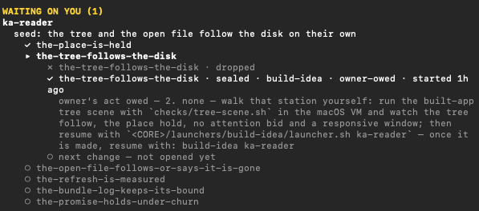</p>
<sub>The run cannot watch a window on a screen, so it names exactly what to check, and how to carry on. A real session, 2026-11-05.</sub>
</details>

#### Ask in a session

```text
> why did the walk on my-app stop?

  It stopped at build-idea, waiting on you. The station's change is sealed, but its done says a
  person must see the app's window follow the files on disk. Open the app, check that, then say
  "resume build idea for my-app".

> checked. it follows. resume build idea for my-app

  Resumed. The queue goes on from the station's close.
```

<sub>An example of the shape of a session, not a transcript.</sub>

#### Unattended runs

Every walk can also run from the terminal, with no session open. Each launcher starts its run in the
background, with a fixed prompt, and reports on the panel and to your notifier when it ends. Each
takes `--stop`, and running it again carries on from what is on disk.

| Launcher | What it runs |
|---|---|
| `prd-and-finish-line <project>` | The PRD, then the finish line. |
| `product-docs <project>` | The product's whole document chain. |
| `build-idea <project>` | The next moves the route's last review left, as a queue. |
| `walk <project>` | One change's whole life, from its station to its seal on `main`, then the route's review. |
| `change <project>` | The change pipeline alone, step by step. |
| `skill <skill> [<argument>...]` | Any one skill that declares an unattended launch. `--dry-run` shows what it would run. |

Each is `core/launchers/<name>/launcher.sh`. For example:

```bash
core/launchers/skill/launcher.sh seed-pick <project>
```

`seed-pick` is the PM's skill: it picks the next seed to walk. The launcher gives the run the PM's
group of skills itself. To run it in a session instead, add the group first:

```text
/add-dir skills/pm
> pm: /seed-pick
```

### Interactive session

Some work is best done with you in the room. Give the session a group of skills with `/add-dir`.
A session sees only the skills you give it, so its context holds what the work needs and nothing
else. [Context](about/under-the-hood.md#context) under the hood explains why.

```text
/add-dir skills/interactive        # hand work to a background agent, answer what a run left open, close the session
/add-dir skills/principal-pm       # seeds-from-idea
/add-dir skills/tech-lead          # ad-hoc-plan
```

- **`seeds-from-idea`** cuts an idea into seeds the PM can pick. The session drafts a short brief
  from your own words, you confirm it, and the cut runs from it.
- **`ad-hoc-plan`** plans a change you opened yourself, in one pass: a short spec, a short design and
  a full plan for the developer. Here too, you confirm the brief first. The walk then builds it
  from implementation on. Every run leaves a report beside the brief: what it did with each line of
  your ask, and why it stopped if it did. `ad-hoc-plan` is useful for a project whose *Definition* is
  `none`.

#### Hand work to an agent: `agent-invoke`

**Work with one session, and let it delegate.** With the `interactive` group added, ask in plain
words, or name the skill:

```text
/add-dir skills/interactive
> get an agent to research how other tools cap a run's context, and report back
> /agent-invoke cold-read on the branch
```

`agent-invoke` hands research, an investigation, a plan or a bounded change to an agent in the
background of your session, and you keep working.

- **It picks the model** by where the judgment in the work lives: authoring or deciding takes a top
  tier, applying a plan already decided the worker tier, a mechanical change made many times the
  cheap tier.
- **It writes the agent a brief** that holds up when read cold, and keeps your Mac awake while the
  agent runs.
- **The agent commits what it produces**, and writes a report of its run.
- **When the agent ends**, the session reads the report, checks it against the repository and tells
  you what held. Your notifier gets a message too.

It is not for work a launcher already does, such as building a change, or for work small enough to
do in the session itself.

<details>
<summary>See it: a cold read handed to an agent</summary>
<br>
<p align="center">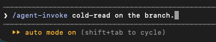</p>
<p align="center">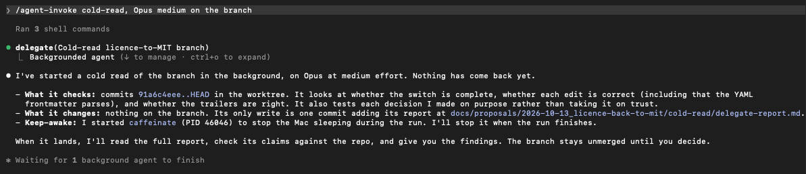</p>
<sub>A real session.</sub>
</details>

### KensaiApp Panel

To watch the walks and changes, KensaiApp has a panel, built as a Claude Code *mod*.

- **The panel.** A Claude Code plugin in `core/tools/kensaiapp-panel/`. Add its absolute path to
  `CLAUDE_CODE_PLUGIN_DIRS` in your `~/.claude/settings.json`, restart, and run `/kensaiapp-panel`.
- **Telemetry.** What each run costs, in tokens and money, through
  [ka-telemetry](https://github.com/eyalgo/ka-telemetry). The how-to guide's
  [How to collect telemetry](about/how-to.md#how-to-collect-telemetry) sets it up.

Everything else works without them. Step by step: the [how-to guide](about/how-to.md).

## Under the hood

For software and AI engineers, the details: [Under the hood](about/under-the-hood.md).

## Examples

KensaiApp comes with two examples.

- **tracker17**, a simple task tracker. `Definition: full`: every product document, then the code.
  Built with KensaiApp, and used to build it.
- **swe-benchmark-poc**, issues from SWE-bench Verified, chosen from those KensaiApp worked on
  2026-10-10 and 2026-10-11. `Definition: none`: KensaiApp was given only
  the repository before the fix and the issue's text. Each issue keeps its patch and its trail.

### Built with KensaiApp

- [ka-telemetry](https://github.com/eyalgo/ka-telemetry): per-agent tokens, time and cost for
  Claude Code, on your own machine. On PyPI as [`ka-telemetry`](https://pypi.org/project/ka-telemetry/).
  KensaiApp's own telemetry runs on it.

KensaiApp is young. It is building more apps in private, and some will go public, as open source,
when they are ready. Below, one of them, in Rust and Swift, tested by hand in a macOS virtual machine.

<p align="center">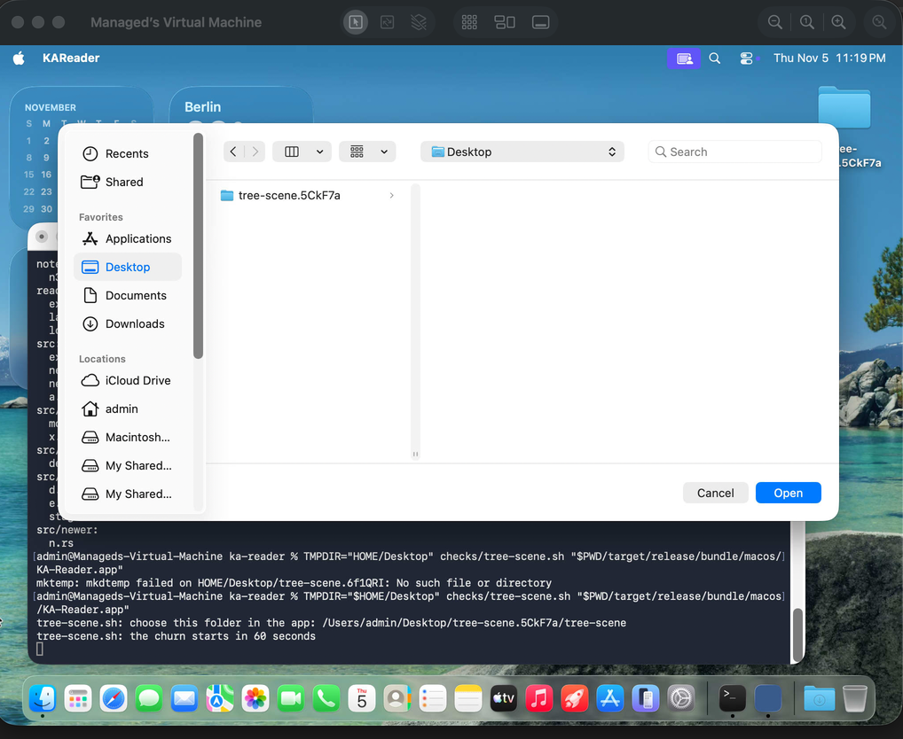</p>
<sub>A manual test in a macOS virtual machine, 2026-11-05.</sub>

## Purpose

KensaiApp exists to take a product from a goal written down to done, with every step on the record.
It was written for its author's own use. It may help people looking for a spec-driven, multi-agent
system that builds apps, and AI and software engineers looking for ideas.

### Limits

KensaiApp is young, and honest about it. Here is what to expect.

- **It has not been measured against a usual developer workflow, or compared with other tools.** If
  you try both, an issue telling how it went is welcome.
- **It is one person's project.** There is no support plan and no roadmap with dates, so a fix may
  take a while. Issues are welcome, and Eyal reads them.
- **Releases are numbered 0.x:** anything may change between them.
- **Pull requests are not accepted for now.** [CONTRIBUTING](CONTRIBUTING.md) says why, and the
  better ways to help.
- **Its own tests grew up on the author's Mac.** The tools and launchers suites now pass on a
  stranger's machine too. A few others may still fail on Linux, as `root` or from a shallow clone,
  because of the machine, not the code.
- **The roles run on your machine**, not inside the containers its tests run in.

### Currently working on

- **Security, step two.** The security step gains scanners for dependencies, code and secrets, with
  its bookkeeping in a tested tool.
- **QA in the pipeline.**
- **A red `main` opens its own repair.** Today an advisory that turns `main` red is repaired once.
  Next, any red `main` opens the change that fixes it, instead of stopping the walk.
- **A usage report with each release**: what building it cost, by step and by model.
- **Refactoring**: improving code that was written earlier.

### Docs

The guides, in reading order.

- [Under the hood](about/under-the-hood.md): how it works, for software and AI engineers.
- [How-to guide](about/how-to.md): step by step, for each task this README outlines.
- [What is in it](about/what-is-in-it.md): each part, what it gives you and how it works.
- [Architecture overview](about/architecture.md): how it is organised, the journey's names, and the
  rules the system enforces.
- [Glossary](about/glossary.md): every word KensaiApp uses.
- [Agentic description](about/agentic_description.md): KensaiApp in agentic-engineering terms.
- [Background](about/background.md): where it came from, and who made it.

### Licence

KensaiApp's own work is under the [MIT licence](LICENSE). Some parts come from other people's
published work, each under its own licence; [NOTICE](NOTICE) lists them.

---

<p align="center"><b>Write the finish line. Walk away. Read the trail.</b></p>
<p align="center"><sub>Made by Eyal</sub></p>
