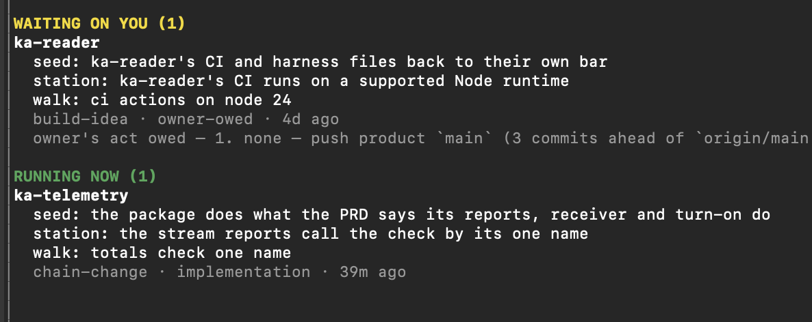
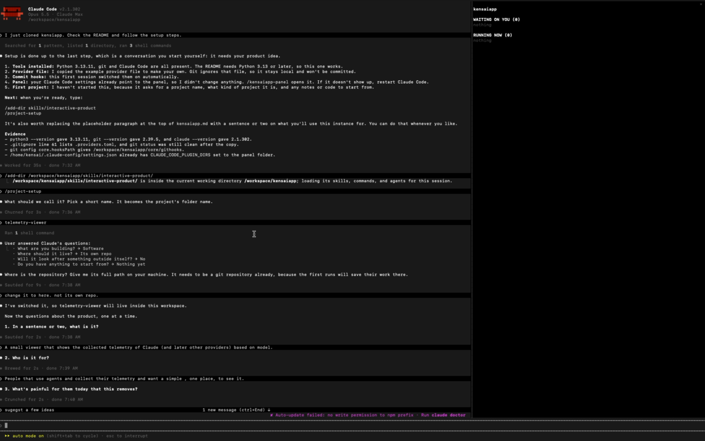
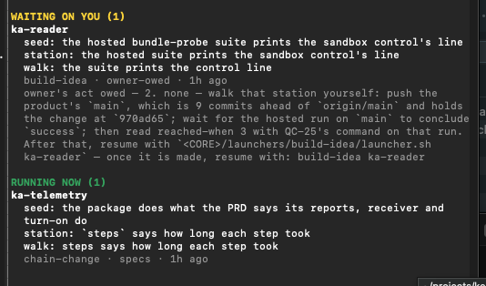

<div align="center">

<h1>KensaiApp</h1>

<p><strong>A software factory on Claude Code: AI roles carry a product through the development lifecycle, from requirements to merged code, under tests and review.</strong></p>

<p>


</p>

<p><a href="#getting-started">Getting started</a> · <a href="#how-kensaiapp-is-organised">How it is organised</a> · <a href="#from-requirements-to-a-product">From requirements to a product</a> · <a href="#interactive-sessions">Interactive sessions</a> · <a href="#using-launchers">Launchers</a> · <a href="#rules-the-system-enforces">Guardrails</a> · <a href="#still-changing">Still changing</a></p>

</div>

KensaiApp started as an experimental private project, which grew into a public one. It was built as
an agentic software development system on Claude Code, and it covers the software development
lifecycle (SDLC), from requirements to merged code. The idea was to "teach" the model and its agents
software engineering principles by running their work through that full lifecycle: requirements,
design, a plan, tests written before the code, and review.

Some of its skills were inspired by published work: [agent-skills](https://github.com/addyosmani/agent-skills)
by Addy Osmani, [claude-superskills](https://github.com/ericgandrade/claude-superskills) by Eric
Andrade, and Anthropic's [skill-creator](https://github.com/anthropics/claude-plugins-official/tree/main/plugins/skill-creator).
[NOTICE](NOTICE) lists the parts that come from them, each under its own licence.

One of the first ideas was that it would build itself, as dogfooding: Claude wrote all of
KensaiApp's code through KensaiApp's own mechanics. The code of the products it builds is written
entirely by KensaiApp.

It is maintained privately, so there is no promise of support and no roadmap.


<p align="center"></p>
<p align="center"><sub>The pane from <code>/kensaiapp-panel</code>: one project waiting on its owner, one running. A real session. ka-reader and ka-telemetry are two projects being built with KensaiApp.</sub></p>

The [how-to guide](about/how-to.md) adds step-by-step detail to this README, for when you need it. The
[glossary](about/glossary.md) explains each word, and the
[agentic description](about/agentic_description.md) maps KensaiApp onto agentic-engineering terms.

## How KensaiApp is organised

You work in an instance: one git repository that holds KensaiApp's shared core, its roles and
skills, and your projects. An instance has a *bearing*, its Michi 道, one or more long-term directions
declared once and never finished.

A project is the work of building one product: its card, its journey and
its open questions, under `system/projects/<name>/`. The product is what gets built: its code and its
own decision documents, such as its requirements and its architecture records. A product can be a
whole application or only part of one. The project's card points at the product by path. The product can sit inside the instance, under `products/`, or in a git
repository of its own. One instance can hold several projects, each with its own product.

### Roles and overlays

The work is split between roles, as in a software team: a PM, a product owner, an architect, a tech
lead, a developer, a senior engineer and others. Every run works as one of them. A
role is defined once, in the shared core. An instance can lay an overlay over it: a short file that
states only what is different about that role in that instance, such as the files it reads there
first. The rules the roles follow are layered the same way: the core's, then the instance's, then a
project's.

### The instance's experience

Each instance also has an experience layer: what every product under it may and may not look like
and sound like, in a visual pair and a voice pair of files under `system/experience/`. The skills
`experience-visual` and `experience-voice` write them, in that order. Neither asks you anything while it
runs; what it cannot settle it leaves as open questions beside the files. Run them from your shell:

```bash
core/launchers/skill/launcher.sh experience-visual
core/launchers/skill/launcher.sh experience-voice
```

Or in a session, as the role that owns each:

```text
/add-dir skills/cdo
> cdo: /experience-visual

/add-dir skills/content-manager
> content-manager: /experience-voice
```

### One mechanism, several instances

A host is an instance that keeps the shared core. A satellite is an instance with no core of its
own: it reads its host's, so a change to the core reaches every satellite as soon as it lands. That
lets you keep different work in different repositories, all run by the same mechanism. KensaiApp itself is
built that way, from one host with satellites beside it. You don't need satellites: a single instance works on its
own. [More than one instance](#more-than-one-instance) shows how to set one up.

## Getting started

### 1. Install what KensaiApp uses

- Claude Code
- Python 3.13 or later, as `python3`
- git

KensaiApp's hooks and launchers run whichever `python3` your shell finds first, so
`python3 --version` must show 3.13 or later. On a Mac, the `python3` that Apple's command-line
tools install is older, and the launchers fail on it. What only some parts need is in the how-to
guide's [How to install what KensaiApp uses](about/how-to.md#how-to-install-what-kensaiapp-uses).

### 2. Clone, and make your provider file

```bash
git clone https://github.com/eyalgo/kensaiapp.git
cd kensaiapp
cp .providers.toml.example .providers.toml
```

### 3. Open Claude Code in the clone

The first session switches on KensaiApp's commit hooks. If the clone already has hooks of its own,
they are kept, and KensaiApp's commit check then runs only in runs a launcher starts.

### 4. Turn on the panel

The panel is a Claude Code mod, a plugin that ships in `core/tools/kensaiapp-panel/`. Nothing in the
clone turns it on. Add its absolute path to the `env` block of your own `~/.claude/settings.json`,
then restart Claude Code:

```json
"env": { "CLAUDE_CODE_PLUGIN_DIRS": "/absolute/path/to/kensaiapp/core/tools/kensaiapp-panel" }
```

`/kensaiapp-panel` then opens the pane in any session inside an instance. The step is optional:
everything else works without it.

### 5. Collect telemetry

This step is there if you want to collect telemetry: what each run costs in tokens and money, and each
request it makes to the model. Skip it otherwise: everything else works without it.

Start the receiver in its own terminal, in the clone, and leave it running. It writes what it
receives to the folder after `--dir`:

```bash
mkdir -p ~/.claude/tools/otel-receiver
python3 core/tools/otel_receiver.py --port 4318 --dir ~/.kensaiapp/telemetry \
  --publish-endpoint ~/.claude/tools/otel-receiver/endpoint
```

Every chain a launcher starts then sends its telemetry there. For your own Claude Code sessions to
send theirs too, run this once, from the clone, while the receiver is running:

```bash
python3 core/tools/apply_telemetry_env.py --settings-file ~/.claude/settings.json
```

It writes the telemetry settings into your Claude Code settings, so it holds for every session on the
machine, not only in KensaiApp. The same command with `--remove` takes them out. The receiver stops
when its terminal closes; start it the same way again. [Telemetry](#telemetry) says what is collected.

### 6. Set up your first project

```
/add-dir skills/interactive-product
/project-setup
```

`/project-setup` turns your product idea into a project in one plain-language conversation, then
starts the chain that writes the project's requirements document (PRD) and its definition of done.

It asks for the project's name first, then what kind of project it is, and whether you have
anything to start from: notes, documents, a CV, old code.
Give their paths or links, with one line on what they are. The project's card records them, and the
run that writes the PRD reads them. They are read as source material, not taken as finished
documents. The [how-to guide](about/how-to.md) takes it from there.

<p align="center"><a href="about/images/getting-started.mp4"></a></p>
<p align="center"><sub>A fresh clone set up in a container, then <code>/project-setup</code> for a new project. Click for the recording: 48 seconds, no sound. A real session.</sub></p>

#### Types of projects

Some of the setup's answers decide a project's shape.

Where the product lives:

| Answer | What it means |
|---|---|
| Here (internal) | The product is a folder in the instance, `products/<name>` |
| Its own repo (external) | The product is a git repository that already exists, at an absolute path. The setup commits once in the instance and once in the product's repository |

How much of the product is written down before the code, on the card's `Definition:` line:

| Value | Chain | What it writes |
|---|---|---|
| `full` | `chain-product` | Every product document, from the PRD to the architecture records (see [Product documents chains](#product-documents-chains)) |
| `prd-agari` | `chain-agari` | The PRD and the definition of done only |
| `none` | none | No product documents. Each change is built from its own request |

`/project-setup` sets `full` for software and `prd-agari` for a product with no code. To choose
another, edit the line on the card.

## The Japanese names

The parts of a project's journey, described in the next section, have Japanese names, in the same
family as the word kensai. The table gives the
nearest industry term first.

| Industry term | KensaiApp's word | What it is |
|---|---|---|
| Long-term direction | Michi 道 | A direction the whole instance steers by and never finishes |
| Definition of done | Agari 上がり | When one project's product is done |
| Backlog of candidate work | Nemawashi 根回し | The seedbed: ideas, each a candidate route toward done |
| Milestone | Shukuba 宿場 | A station: the one stretch of work being walked now |
| Merged pull request | Tobiishi 飛び石 | A stepping stone: one change carried from ask to sealed on `main` |

Each term is the nearest match, not an exact one. Where each comparison ends is in the glossary's
section [The journey in industry, ticketing and Jira terms](about/glossary.md#the-journey-in-industry-ticketing-and-jira-terms).

## From requirements to a product

Once a project is set up, its journey can start. The journey is how a project gets from its
documents to its definition of done, and after the first launch it walks itself:

1. The Principal PM cuts the product's documents into seeds (`seeds-from-product-docs`). A seed is a
   candidate route toward done, with a checklist of stations.
2. The PM picks one seed (`nemawashi-pick`) and cuts its checklist into the stations to walk
   (`stations-from-seed`).
3. `chain-change` opens a station (`shukuba-open`), opens a change in it (`tobiishi-open`), and carries
   the change through the pipeline to the seal (`tobiishi-seal`). A station that is not reached can be
   parked (`shukuba-park`) and opened again later.
4. After every sealed change, the PM refines the station (`shukuba-refine`) and writes the next moves:
   another change, or closing the station.
5. The Scrum Master closes a station once it is reached (`shukuba-retire`). When a seed's checklist is
   walked, the Scrum Master retires the seed (`nemawashi-retire`), and the Principal PM refines the
   seedbed (`nemawashi-refine`): a new cut from the documents, or the next pick.

```
CUT             PICK            STATIONS        CHANGE
┌───────────┐   ┌───────────┐   ┌───────────┐   ┌───────────┐
│ Principal │──▶│ PM        │──▶│ PM        │──▶│ chain-    │◀─┐
│ PM        │   │           │   │           │   │ change    │  │ next change
└───────────┘   └───────────┘   └───────────┘   └───────────┘  │
      ▲               ▲                               │        │
      │ new cut       │ next pick                     ▼        │
┌───────────┐   ┌───────────┐   ┌───────────┐   ┌───────────┐  │
│ Principal │◀──│ Scrum     │◀──│ Scrum     │◀──│ PM        │──┘
│ PM        │   │ master    │   │ master    │   │           │
└───────────┘   └───────────┘   └───────────┘   └───────────┘
REFINE SEEDS    RETIRE SEED     CLOSE STATION   REFINE
```

Once it starts, it runs without you. It stops when it needs you, for an act only you can do or a
question only you can answer, when a step fails, or when you stop it. It ends when no seed is left and
nothing is owed. The last refine says so, and whether the product has reached its done is your call.

### How a change moves

Every change goes through the same pipeline. Each box is a separate agent run with its own role,
and a program, not a model, decides which step runs next: it starts a step only once the run before
it has ended and left its result on disk.

```
ASK             SPEC            DESIGN          PLAN            CONTENT *
┌───────────┐   ┌───────────┐   ┌───────────┐   ┌───────────┐   ┌───────────┐
│ PM        │──▶│ Product   │──▶│ Architect │──▶│ Tech lead │──▶│ Content   │
│           │   │ owner     │   │           │   │           │   │ editor    │
└───────────┘   └───────────┘   └───────────┘   └───────────┘   └───────────┘
                                                                      │
                                                                      ▼
                SEAL            AUDIT           PROVE           BUILD
                ┌───────────┐   ┌───────────┐   ┌───────────┐   ┌───────────┐
                │ PM        │◀──│ Auditor   │◀──│ Senior    │◀──│ Developer │
                │           │   │           │   │ engineer  │   │           │
                └───────────┘   └───────────┘   └───────────┘   └───────────┘

* the content step runs only when the change's design says it publishes text
```

| Step | Role | What it leaves |
|---|---|---|
| Ask | PM | A change request: the next change the project's current work calls for |
| Spec | Product owner | A testable specification of the change |
| Design | Architect | How the change is structured against the system that exists |
| Plan | Tech lead | An executable plan, with the gaps in the design filled |
| Content | Content editor | The exact words the change puts in front of a person |
| Build | Developer | The code, each test written before the code it checks |
| Prove | Senior engineer | Proof that the code does what the change intends, with the tests nobody wrote |
| Audit | Auditor | One findings file per step it reviews; it lists defects and never fixes them |
| Seal | PM | The change merged into `main`, and its folder moved to where sealed changes are kept |

The audit never stops a change from moving on. Its findings are kept on branches of their own and
joined into the change at the seal.

### Product documents chains

A project's documents are written by a chain of their own, the one its card's `Definition:` line
names. `chain-product` walks them in a fixed order, and each is written by the role that owns it:

| Document | What it is | Written by |
|---|---|---|
| PRD | The product's requirements | CPO |
| Agari | The definition of done | CPO |
| SRS | The software requirements specification | CTO |
| UXD | The user experience (experimental) | CDO |
| DESIGN | The design language | CDO |
| CONTENT | The content standard: voice, terms, message patterns | Content Manager |
| SDD | The software design | CTO |
| FDR | Functional design requirements: the behaviour every later change is built against | Principal PM |
| ADR | Architecture decision records, one per significant decision | Principal Architect |
| NFDR | Non-functional design requirements: the rules a later change must not break | Principal Architect |

`chain-agari` walks the PRD and the Agari only. A document that is settled, with no open questions, is
walked past without a run. `chain-change` runs the project's documents chain before each change, so a
document with open questions is dealt with before the next change starts.

When the documents have settled, you run one launcher yourself. A model run writes the card's fields
for the product's languages and test command, and the product's README. The launcher then copies a
code skeleton for each unit the software design names, with no model involved. It runs in the
foreground and waits for both halves, and it sends no message:

```bash
core/launchers/product-card/launcher.sh my-app
```

#### How a document's open questions get answered

A run that writes a document does not stop to ask you. What it cannot settle, it writes as open
questions in a companion file beside the document. The chain then starts an answering run,
`companion-self-answer`, in the seat of the role that owns the document. It decides every item it is
allowed to decide. An item only you may settle stays open, with the answer it would have given. It
then lists the runs now owed, and the document's writer runs again and folds the answers in. To
answer the items left for you, use `/companion-answer` in a session
([Interactive sessions](#interactive-sessions)).

### The chain launchers

Each part of the journey above has a launcher:

| Launcher | What it walks |
|---|---|
| `chain-product` | The product documents, PRD to NFDR |
| `chain-agari` | The PRD and the definition of done |
| `chain-change` | One change: open a station if none is open, open the change, the pipeline, the seal and the refine. At its end it starts `build-idea` |
| `build-idea` | The next moves a refine wrote, run as a queue: close a station, retire a seed, pick, cut, or the next change, which starts `chain-change` again |
| `chain-development` | The pipeline from the spec on, for a change whose request already exists |
| `seeds-from-idea` | One idea cut into seeds |
| `product-card` | The card's fields, the product README and the code skeleton |

A documents chain walks a spine: the ordered list of documents its launcher hands to the chain engine.
The change chains have a fixed table of steps instead. All of them share the rest:

- A launcher starts the first run in the background and returns. Each run, when it ends, starts the next.
  `product-card` is the exception: it runs in the foreground and waits.
- The walk's state is one file under `system/logs/`, beside each run's log.
- `chain-product`, `chain-agari`, `chain-change`, `build-idea` and `chain-development` take `--stop`,
  which stops the runs in flight and keeps the state.
- Run the same command again and it carries on from what is on disk, rather than starting over.
- Each launch runs on a pinned copy of the shared core, so an edit made after the launch cannot reach
  a run in flight. `build-idea` takes a new pin when the host has changed, so the queue a walk runs at
  its end can run on newer files.

Most of the time you run one command, and the loop between `chain-change` and `build-idea` does the rest:

```bash
core/launchers/chain-change/launcher.sh my-app
```

## See where things stand

`/kensaiapp-panel` opens a pane in your Claude Code session that lists the chains waiting on
you, and the ones running now ([step 4](#4-turn-on-the-panel) turns it on). For each project it shows
the seed, the station, the change being walked, the step it is on and how long ago that walk started.
When a chain is waiting on you, the pane says what it needs.

<p align="center"></p>

You do the act it names, then tell the session in your own words:

<p align="center"></p>
<p align="center"><sub>Both from a real instance, 2026-10-14.</sub></p>

For the whole picture, `python3 core/tools/journey_status.py --repo .` writes one HTML page of the
instance's journey, with every place it has drifted from the model. It only reads.

### When a run stops, it says why

A chain's closing message names where it stopped and why. Most stops end the same way: you settle
the cause, then run the same launcher again. When you are not sure what a stop means, paste it to
Claude in your instance and ask. A shortened example, with the project renamed:

```text
> the chain in `my-app` is in halt. "owner's act owed: walk that station yourself, then resume
  with build-idea my-app". What and how do I walk that station myself?

  Your move: sort out the station in my-app. Either close it with the Scrum Master's
  `shukuba-retire my-app`, or find out why the queue thinks it is already closed. Then let a
  fresh refine and its queue run.
```

[Restarting a stopped walk](#restarting-a-stopped-walk) shows how to make that move yourself.

## Interactive sessions

Not all work goes through a launcher. Some you want to do with Claude directly, and some you hand
off and come back to: research, an investigation, a plan for a change, or a cold read of a branch by
an agent that did not write it.

### Loading skills and agents

KensaiApp uses progressive disclosure: a session sees only the skills and agents you give it. They
come in groups, one folder each under `skills/`. Give a group when you start Claude Code, where
`<host-path>` is the instance that holds the core:

```bash
claude --permission-mode acceptEdits --add-dir <host-path>/skills/interactive
```

Or during a session:

```text
/add-dir skills/interactive
```

The `interactive` group holds the skills meant for a session with you:

| Skill | What it does |
|---|---|
| `agent-invoke` | Hands work to an agent that runs in the background ([Delegating work](#delegating-work)) |
| `companion-answer` | Walks a document's open questions with you, one at a time, and writes your answers in |
| `seeds-from-idea` | Cuts one idea into seeds, in the project that owns it or in the instance's seedbed |
| `session-close` | Moves what a session produced onto the files that keep it |
| `skill-creator` | Creates or changes a skill |
| `skill-evals-creator`, `skill-evals-trigger` | Write a skill's evals, and tune when it triggers |

The `experimental` group, `skills/experimental`, holds the skills that are still being tried out:

| Skill | What it does |
|---|---|
| `kaizen-audit` | Audits a pipeline skill through something it produced, with blind auditors |
| `skill-evals` | Runs a skill's evals |

### Asking a specific role

Start a message with a role's prefix, such as `pm:`, `cpo:`, `architect:`, `scrum-master:` or `ppm:`
for the Principal PM, and the session works as that role. A role's own skills sit in a group of its
own name, such as `skills/scrum-master`.

#### Restarting a stopped walk

Sometimes a walk stops on a move it leaves to you ([When a run stops](#when-a-run-stops-it-says-why)).
You make the move as the role that owns it, then start the queue again. For the example above:

```text
/add-dir skills/scrum-master
> scrum-master: run shukuba-retire for my-app
```

```bash
core/launchers/build-idea/launcher.sh my-app
```

### Delegating work

Delegation is part of the `interactive` group. With that group added, ask in plain words, such as
"get an agent to research this and report back", or name the skill, `/agent-invoke`. It starts the
work as an agent in the background of your session.

<p align="center"></p>
<p align="center"></p>
<p align="center"><sub>A real session.</sub></p>

The skill picks the model by where the judgment in the work lives: authoring or deciding takes a
top tier, applying a plan already decided takes the worker tier, and one mechanical change made many
times takes the cheap tier. It writes the agent a brief. The agent commits its own work and writes a
report of the run. When the agent ends, the session reads that report, checks it against the
repository and tells you what held.

### Planning a change by hand

`ad-hoc-plan` is the tech lead's plan for a change you open yourself, outside the journey's own
moves. It is work in progress. It needs the change opened first: one open change in the project,
with its change request committed. The PM's `tobiishi-open` writes one, or you can write it by hand.
The product can live inside the instance or in its own repository.

```text
/add-dir skills/pm
> pm: tobiishi-open for my-app

/add-dir skills/tech-lead
> tech-lead: ad-hoc-plan for my-app
```

The skill opens the change's branch and working folder itself. It writes a short spec, a short design
and a full plan for the developer, commits them, and names the next command without running it:

```bash
core/launchers/chain-development/launcher.sh my-app
```

### Cutting seeds from an idea

`seeds-from-idea` does for one idea what `seeds-from-product-docs` does for a project's documents:
the Principal PM cuts it into seeds, each with its station checklist and a trace back to the idea,
in the project that owns it, or in the instance's own seedbed.

```text
/add-dir skills/interactive
> ppm: seeds-from-idea <the idea, or a path to a note>
```

A new seed waits to be picked. Pick one as the PM, then start the change chain, and the journey
walks itself from there:

```text
/add-dir skills/pm
> pm: nemawashi-pick my-app
```

```bash
core/launchers/chain-change/launcher.sh my-app
```

### How a session talks to you

Every session and every agent is given the same rules for replying to you, at its start: the answer
first, in one plain sentence; then why, in a few short numbered lines; everyday words; what happens
next; and the evidence last. Where a skill fixes the words of a message, those words win.

The rules live in one file, `core/doctrine/governance/talking_to_the_owner.md`, under its heading
"The rules". A hook copies that section word for word into every session and every agent when it
starts. To change how sessions reply to you, edit that section; the next session takes the change. In
a satellite, the file is the host's.

## Choosing a provider

`.providers.toml` names the provider for each document, each step and each kind of queue row. Without
a flag, and without `KENSAIAPP_AGENT_PROVIDER` exported, every launch reads the file as it stands, so an edit reaches the next step of a walk already
running.

`--provider claude|codex|gemini|hf|ollama` picks one provider for the whole walk instead. It is saved
with the walk and holds until the walk ends, including the queue `chain-change` starts at its end. If
you start `build-idea` again by hand, give the flag again: a start without it reads the file.

Exporting `KENSAIAPP_AGENT_PROVIDER` before a launch forces one provider as the flag does. These
launchers run on Claude only, whatever the flag or the variable says: `cold-read`, `launch-eval-fix`,
`launch-skill-evals`, `product-card`, `seeds-from-idea`, `launch-apply-packet`, `launch-audit` and
`launch-fix-author`.

KensaiApp is tested and mostly run on Claude. The other providers can be part of the loops, with
gaps, the biggest in interactive mode.

## Using launchers

A launcher is a script you run outside a Claude Code session. Each starts its work as background
runs and returns, except `product-card`, which waits. You can also ask Claude in a session to run one for you, instead of loading a
role's group.

```bash
core/launchers/chain-change/launcher.sh <project>        # one change, ask to seal, then the next moves
core/launchers/build-idea/launcher.sh <project>          # a refine's next moves, as a queue
core/launchers/chain-product/launcher.sh <project>       # a project's product documents
core/launchers/chain-agari/launcher.sh <project>         # a project's PRD and definition of done
core/launchers/seeds-from-idea/launcher.sh <idea-path>   # one idea cut into seeds
core/launchers/skill/launcher.sh <skill> [<argument>...] # any skill that has a launcher.md
core/launchers/cold-read/launcher.sh ...                 # blind cold reads over a skill's own stack
```

## More than one instance

A satellite is an instance that reads its host's core ([One mechanism, several
instances](#one-mechanism-several-instances)). Satellites are work in progress: a script stands one
up, and no skill or launcher wraps it yet.

You can ask for one in a session, in plain words. It asks for the satellite's name, the folder to put it
in, and whether it keeps its own copy of the skills:

<p align="center"></p>
<p align="center"><sub>A real session.</sub></p>

Or run the script from the host:

```bash
python3 core/tools/spawn_satellite.py --name kensaiapp-<name> --location <parent-dir> --host <host-path> ...
```

`--help` lists the script's other options. The host keeps a list of its satellites, and you add the
new one to it by hand.

A satellite has no `core/` folder, so its launchers are reached through the host's. To launch from a
shell in a satellite, load the satellite's `.env` first. Its `CORE` line points at the host's core:

```bash
cd <satellite-path>
set -a; . ./.env; set +a
"$CORE/launchers/chain-change/launcher.sh" my-app
```

## Findings

Findings are where KensaiApp records the defects it finds in itself. The chains write them, and the
PM and the Principal PM work from them: the PM reads each change's audit findings when it refines the
station, and the Principal PM files the defects it finds when it refines the seedbed. Findings are
also how KensaiApp's own defects get fixed, by hand for now.

A finding is a defect in KensaiApp itself, such as in a skill, a prompt, a rule, a hook or a launcher,
noticed while doing something else. A small one is fixed in place, on the branch where it was
found. A larger one becomes a seed. One that is not fixed is written to
`docs/findings/<date>_<slug>.md`, in a commit of its own. A finding stays in the instance where it
was written; nothing carries it to the host.

In the pipeline, the audit step writes one findings file per step it reviews, as
[How a change moves](#how-a-change-moves) shows.

In a session, ask Claude to write a finding to `docs/findings/`. `/session-close` turns loose findings
from a session into a seed in the project that owns them.

In a satellite, a finding is written to the satellite's own `docs/findings/`, even when the defect is
in the host's core. Carrying it to the host is yours to do. This is work in progress, and nothing
moves findings between instances automatically.

## Additional features

### Each skill runs at its own model and effort

The work sets the intelligence, not the role that runs it. Two skills run by the same role may need
very different thinking: closing a change by procedure is not the same job as deciding what a
station becomes. So each skill declares the model and the effort it runs at, in one file per
provider beside its `SKILL.md`:

```
skills/<group>/.claude/skills/<skill>/intelligence/claude.md
  **Model:**  the exact model ID
  **Effort:** the effort level
  and the reason for both
```

The values in this release are considered defaults, not yet fully tuned. You can change
them by editing that file.

### Language packets

A language packet holds the engineering rules for one language: its toolchain, layout, quality
gates, conventions, errors and logging, testing, and where its gates run. There are packets for
JavaScript, Python, Rust, Shell, Swift and TypeScript. A change takes the languages its project's card
names; without them, the languages of the product's files. A language with no packet falls back on a
floor of rules that holds for any language.

Each packet also names the container image or virtual machine its gates run in, which
[Testing in isolation](#testing-in-isolation) describes. A code skeleton per language is what
`product-card` copies.

### Testing in isolation

A product's tests run where its continuous integration runs, not on whatever machine started the
walk. The developer's run, the senior engineer's proof and the seal each run the product's test
command in the environment the product's CI calls for, and each records which environment that was:

| The product's CI runs on | Its tests run in |
|---|---|
| Linux | A Podman container, from the image the language's packet names |
| macOS, or the product holds Swift | A macOS virtual machine, under Tart |
| No CI | Your own Mac |

On a Mac, Podman runs its containers inside a virtual machine of its own, which `podman machine init`
creates once. A product's own decision files can override its language's default. To run a walk's
tests on your own Mac anyway, ask for it when you start the walk:

```bash
core/launchers/chain-change/launcher.sh my-app --gate-owners-mac
```

The ask is kept with the walk, so a resume keeps it.

Only the tests run in a container or a virtual machine. The agents themselves run on your machine.

### Notifications

A run can message you through a program you name in `KENSAIAPP_NOTIFIER`: the full path of an
executable that takes the message as its one argument and exits 0 when it sent it. Set it in your
shell profile. With the variable unset, nothing is sent.

What sends a message:

- every chain launcher, when it starts and when it ends, with the reason it ended (`product-card`
  sends none);
- a delegated agent, when it finishes;
- a run started with `--keep-awake`, which needs a notifier set.

#### Telegram

KensaiApp does not ship a Telegram script; you write a short one:

1. Send `/newbot` to @BotFather and keep the token it gives you.
2. Send your bot a message, then read your chat's `id` from the bot's `getUpdates`.
3. Write a script that posts its argument to `https://api.telegram.org/bot<token>/sendMessage` with
   that `chat_id`, reads the token from your keychain or environment, and exits non-zero when
   Telegram rejects the message. A message is at most 4096 characters.
4. Make it executable and point `KENSAIAPP_NOTIFIER` at it.

The [how-to guide](about/how-to.md) has the details.

<p align="center">


</p>
<p align="center"><sub>Messages from a Telegram notifier, as runs start, pause and end. The instance's name is covered.</sub></p>

### Telemetry

Claude Code can export its usage as OpenTelemetry: tokens and cost per run, and each API request and
finished agent. KensaiApp ships a receiver that appends what it receives to files on your machine.
[Step 5](#5-collect-telemetry) of Getting started turns it on.

A launcher finds the receiver through the file `--publish-endpoint` writes. Without that file, it
starts its runs with no telemetry.

A launcher exports a run's telemetry only to a receiver at a loopback address, and refuses any other
host. It tags each run with its provider, model and effort, so they can be read back afterwards from
what actually landed, not from what the launcher meant to send. Scripts in `core/tools/` read it back
per agent, per run and per chain.

Running the receiver as a background service on your machine is out of KensaiApp's scope; the
receiver itself ships with KensaiApp.

## Rules the system enforces

Some of KensaiApp's rules are held by code rather than by the model: hooks, a commit check and the
launchers.

| Guard | What it does |
|---|---|
| `development-bash-approve.py` | Approves a Bash call only when every command is in a conservative safe set; anything else goes to the normal permission prompt |
| `read_first_guard.py` | Refuses an agent run's acting calls until it has read the files its agent file tells it to read first |
| `brief_anchor_guard.py` | Refuses to spawn an agent whose brief cites something that is not there |
| `written_forward_guard.py` | Refuses a write that narrates a file's own state into a scoped document |
| `context_cap.py` | Tells a developer run past its context cap to finish its task, commit, and hand over to a fresh run |
| `task_map_salience.py`, `manifest_salience.py`, `standing_rules_salience.py` | Inject, at every session and subagent start, the task-to-rule map, the map of where files live, and the rules that bind without being looked up |
| `commit-msg` check | Refuses a commit or merge that lacks its required trailers, such as `Role:` and `Surface:` |
| Permission mode | A launched Claude run uses Claude Code's auto permission mode, and no launcher bypasses permissions. A run started in the background, the default, can still stop on a prompt and wait; a print run takes none, so an action it would have to ask about is denied and the run carries on |
| Product checkout | A run that leaves new uncommitted changes in the product's checkout halts the walk, with nothing relaunched over them |
| Pins | A launched run reads a frozen copy of the shared core, so an edit made after the launch cannot reach it. `build-idea` takes a new pin when the host has changed |
| Worktrees | Each change gets its own branch and working folder |

Where an AI decision and a mechanical rule conflict, the rule wins, and the AI says so rather than
working around it.

<details>
<summary>How the skills get better: evals, cold reads and kaizen</summary>

This part is experimental.

- Evals run each case of a skill twice, once with the skill and once without it, and grade each run.
- Kaizen exercises a skill against a real case, audits what the run produced, improves the skill and
  runs it again, round after round. Each auditor loads only its own lens.
- The cold-read launcher opens blind cold reads over a skill's producing stack.
- Deciding a fix and applying it are kept in separate hands: a fix-author decides, and a fixer applies
  what it decided without deciding again. In a kaizen round, the fixer acts only on a fix packet the
  owner has marked approved; after a cold read or an eval run, it applies the fix-author's decision
  directly.
- Ratifying a skill is the owner's call, not a gate the auditors hold.

</details>

## Examples

KensaiApp ships with these examples.

- tracker17, in `products/tracker17` and `system/projects/tracker17`: a simple task-tracking app.
  KensaiApp built it, and it was used to build KensaiApp. It is a work in progress, developed
  alongside KensaiApp, and published as an example of KensaiApp's output.
- swe-benchmark-poc, in `products/swe-benchmark-poc` and `system/projects/swe-benchmark-poc`: a proof
  of concept of how KensaiApp handles a different kind of input. It holds issues from the public
  benchmark SWE-bench Verified, chosen from those KensaiApp worked on 2026-10-10 and
  2026-10-11. KensaiApp was given only each repository as it stood before the fix, and the issue's
  text. Each issue keeps its patch, and its change's trail from the request to the integrity report.
  The project's card sets `Definition: none`, so each change was built from its own request.

## Still changing

KensaiApp changes as it is used. None of what follows has a date, and none of it is in this release.

- Satellites are stood up by a script, with no skill or launcher around it yet.
- The priority was to build it first, and later to add evals and improve its prompts, skills and more.

## What it does not promise

There is no support, no stability promise and no roadmap. Issues are welcome as input, but a
reported problem may not be fixed quickly. Outside contributions are not accepted for now, maybe later.

KensaiApp was written for its author's own use, and it has not been compared with other
solutions. In its author's view, it can still help two groups: people looking for a spec-driven,
multi-agent system that builds apps, and AI and software engineers looking for ideas.

KensaiApp's output has not been evaluated against the output of another way of working.

## From the author

Very early after I started working with Claude, I noticed that although Claude can finish a coding
task, the code it writes is probably not the best. As everyone knows, that comes back to bite us
later.

I started by searching for skills and tools to automate a development process. Inspired by the work
of Addy Osmani on agent-skills, Eric Andrade on claude-superskills and others, it slowly became a
spec-driven, multi-agent development system that can build apps.

<details>
<summary>The name</summary>

Kensai, also written kensei (剣聖), is a Japanese honorary title for a master swordsman of the
highest level. It translates literally as "sword saint". The name came to me on one of those
sleepless nights.

</details>

## Licence

KensaiApp's own work is licensed under MIT, in [LICENSE](LICENSE). Some parts come from other people's
published work, each under its own licence; [NOTICE](NOTICE) lists them.

---

<p align="center">
<a href="about/how-to.md">How-to guide</a> ·
<a href="about/glossary.md">Glossary</a> ·
<a href="about/agentic_description.md">Agentic description</a> ·
<a href="LICENSE">Licence</a> ·
<a href="NOTICE">Notices</a>
</p>
<p align="center"><sub>Made by Eyal</sub></p>
