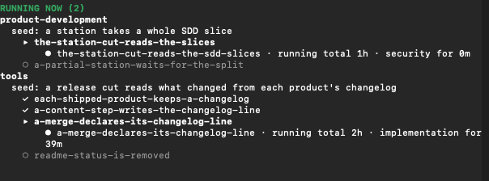

# Background

This page says where KensaiApp came from, what inspired it, and who made it. The
[README](../README.md) says what KensaiApp is and how to start.

## Where it came from

KensaiApp started as an experimental private project, which grew into a public one. It was built as
an agentic software development system on Claude Code, and it covers the software development
lifecycle (SDLC), from requirements to merged code. The idea was to "teach" the model and its agents
software engineering principles by running their work through that full lifecycle: requirements,
design, a plan, tests written before the code, and review. The next idea was to automate it.

Some of its skills were inspired by published work: [agent-skills](https://github.com/addyosmani/agent-skills)
by Addy Osmani, [claude-superskills](https://github.com/ericgandrade/claude-superskills) by Eric
Andrade, and Anthropic's [skill-creator](https://github.com/anthropics/claude-plugins-official/tree/main/plugins/skill-creator).
[NOTICE](../NOTICE) lists the parts that come from them, each under its own licence.

One of the first ideas was that it would build itself, as dogfooding: Claude wrote all of
KensaiApp's code through KensaiApp's own mechanics. The code of the products it builds is written
entirely by KensaiApp.

KensaiApp walking two of its own projects on 2026-11-03: product-development, the roles that design and build a change, and tools, its shared tools. Both are internal projects of the instance where KensaiApp is developed, and neither is a product of its own. A real session.

It is maintained privately, so there is no promise of support and no roadmap.

## From the author

Very early after I started working with Claude, I noticed that although Claude can finish a coding
task, the code it writes is probably not the best. As everyone knows, that comes back to bite us
later.

I started by searching for skills and tools to automate a development process. Inspired by the work
of Addy Osmani on agent-skills, Eric Andrade on claude-superskills and others, it slowly became a
spec-driven, multi-agent development system that can build apps.

The name

Kensai, also written kensei (剣聖), is a Japanese honorary title for a master swordsman of the
highest level. It translates literally as "sword saint". The name came to me on one of those
sleepless nights.

