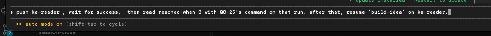
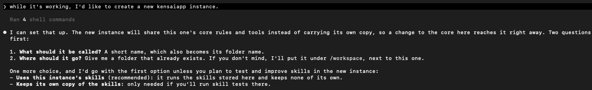
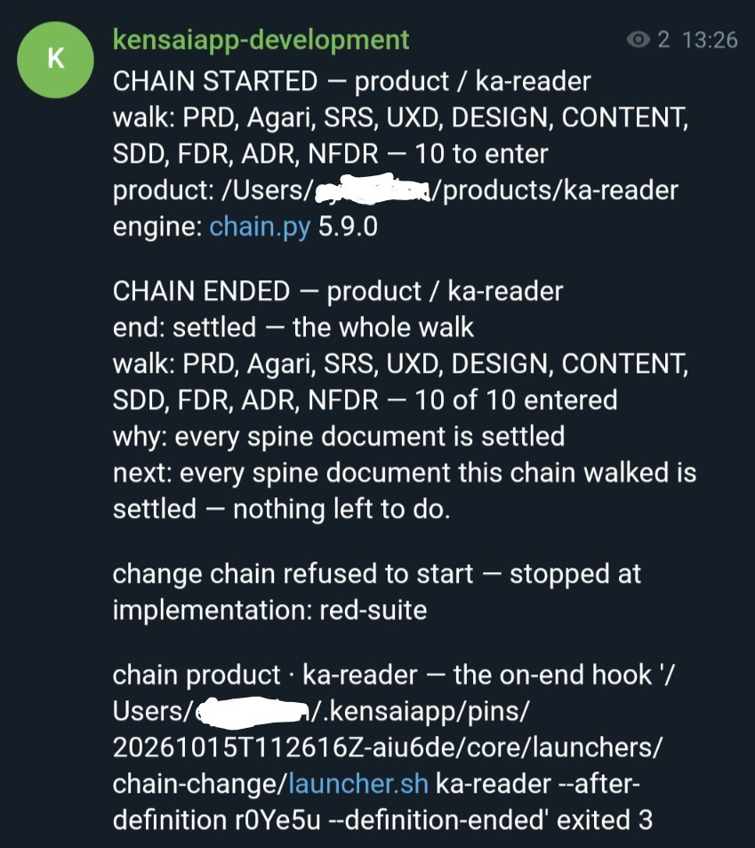
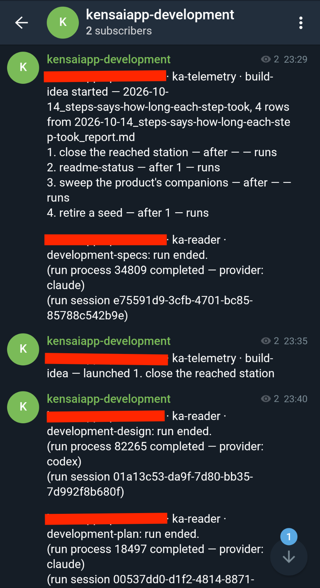
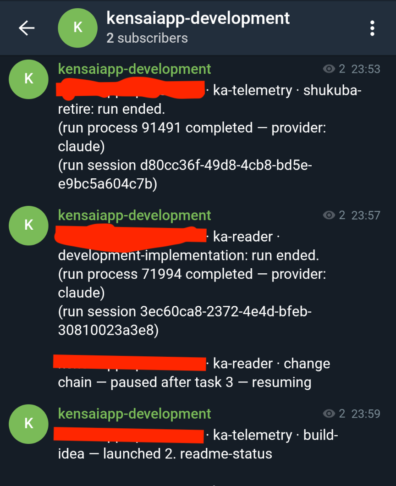

# How to

Each entry is one line, then how to do it in a session, then from the terminal. Every command runs
from the instance root. In a satellite, read every `core/` path as `$CORE`, as
[How to create an instance](#how-to-create-an-instance) shows. The README says what
KensaiApp is; the [architecture overview](architecture.md) says how it is organised.

In a session, a skill needs its group first, `/add-dir skills/<group>`. A launcher gives its run the
group itself.

## How to install what KensaiApp uses

Install uv. KensaiApp runs its Python, and its own tests, through it.

```bash
brew install uv          # or: curl -LsSf https://astral.sh/uv/install.sh | sh
uv run --locked pytest core/tools/ core/launchers/
```

The first run downloads the Python `.python-version` names, 3.14, when your machine lacks it, so it
needs the network. Without uv, a launcher stops and says how to install it.

Some parts need more:

| To use | You need |
|---|---|
| The panel, or the telemetry install | A `python3` of 3.13 or later first on your `PATH` |
| Tests in a container, for a product whose CI runs on Linux | Podman, with its machine running on a Mac: `podman machine start` |
| Tests in a macOS guest, for a product whose CI runs on macOS or that holds Swift | Tart, and the guest `core/doctrine/engineering/languages/swift/environment.md` sets up |
| The `codex` provider | The `codex` command |
| The `gemini` provider | The `agy` command |
| The `ollama` provider | An Ollama server, at `http://localhost:11434` or at `KENSAIAPP_OLLAMA_URL` |
| The `hf` provider | A line `HF_TOKEN=<your token>` in `~/.env` |

A product's own tests run its card's `Test command:`, not KensaiApp's.

## How to run KensaiApp's own tests

Run the core's suite from the instance root. It needs uv, git and `ps` (on Debian, the `procps`
package).

```text
Run KensaiApp's own tests.
```

```bash
uv run --locked pytest core/tools/ core/launchers/
```

Only the first run needs the network, to fetch the Python and the locked test tools. The tests
themselves run with none. Expect about ten thousand tests, all passing, in five to eight minutes.

In a container, start it with an init process: `podman run --init` or `docker run --init`. Without
one, a process that has ended is never cleared, and the tests that wait for one to end fail.

## How to ask a role for help

Start your message with the role's prefix.

```text
> pm: what is the next station for my-app?
```

Every prefix is in the [Loader map](../AGENTS.md#loader-map) of your `AGENTS.md`.

## How to give a session a group of skills

A session sees only the skills you give it, one group per folder under `skills/`.

```text
/add-dir skills/interactive
```

```bash
claude --permission-mode acceptEdits --add-dir <host-path>/skills/interactive
```

A role's own skills sit in a group of its name, such as `skills/pm`. Two groups are not a role's:

| Group | Skill | What it does |
|---|---|---|
| `interactive` | `agent-invoke` | Hands work to an agent in the background ([How to hand work to an agent](#how-to-hand-work-to-an-agent)) |
| | `companion-answer` | Walks a document's open questions with you, one at a time, and writes your answers in |
| | `session-close` | Moves what a session produced onto the files that keep it |
| | `skill-creator` | Creates or changes a skill |
| | `skill-evals-creator`, `skill-evals-trigger` | Write a skill's evals, and tune when it triggers |
| `experimental` | `kaizen-audit` | Audits a pipeline skill through something it produced, with blind auditors |
| | `skill-evals` | Runs a skill's evals |

## How to set up a project

One conversation writes the project's card, then starts the run that writes its PRD and finish line.

```text
/add-dir skills/interactive-product
/project-setup
```

If that run stops, or leaves something for you, answer it and start it again:

```bash
core/launchers/prd-and-finish-line/launcher.sh <project>
```

Once the finish line is settled, start the product's list of what is left to build, once:

```bash
core/launchers/skill/launcher.sh first-what-left <project>
```

The card's `Type:` says what the product is, `software` or `no-code`, and its `Definition:` how much
is written before the code. Change either on the card.

## How to walk a project's journey

Start the walk, and run it again to carry on from what is on disk.

```text
> build idea for my-app
```

```bash
core/launchers/build-idea/launcher.sh <project>
core/launchers/walk/launcher.sh <project>
```

`build-idea` runs the next moves the route's last review left, as a queue. `walk` takes one change
from its station to its seal. The moves and who makes each are in the architecture overview's
[From requirements to a product](architecture.md#from-requirements-to-a-product).

## How to stop a walk, and start it again

Each launcher takes `--stop`. Running it again with no flag carries on; a stopped step starts over.

```text
> stop the walk on my-app
```

```bash
core/launchers/walk/launcher.sh <project> --stop
core/launchers/build-idea/launcher.sh <project> --stop
```

`walk --stop` stops every run in flight and keeps the state. `build-idea --stop` stops its queue,
and a change it already started walks on to its end.

## How to run one skill on its own

Any skill with a `launcher.md` beside its `SKILL.md` runs on its own.

```text
/add-dir skills/pm
> pm: /shukuba-refine my-app
```

```bash
core/launchers/skill/launcher.sh shukuba-refine <project>
core/launchers/skill/launcher.sh seed-pick <project>
core/launchers/skill/launcher.sh seeds-from-product-docs <project>
```

`--dry-run` prints what the launch would run and starts nothing.

## How to hand work to an agent

Ask the session to hand research, a plan or a bounded change to a background agent.

```text
/add-dir skills/interactive
> hand the research on X to an agent
```

The agent picks its model, commits what it produces and writes `delegate-report.md`. Not for work a
launcher already does. More: the README's [Hand work to an agent](../README.md#hand-work-to-an-agent-agent-invoke).

> [!TIP]
> **Work with one session, and let it delegate.** Ask it to hand research, a plan or a bounded change
> to a background agent. It picks a model for the work, and the agent commits what it produces.

## How to see where things stand

Open the panel.

```text
/kensaiapp-panel
```

```bash
python3 core/tools/journey_status.py --repo .
```

The second writes a page of every journey to `system/logs/journey_status.html`, with every place it
has drifted from the model. It only reads. The panel itself is in the README's
[See the walk](../README.md#see-the-walk).

## How to collect telemetry

Install [ka-telemetry](https://github.com/eyalgo/ka-telemetry) once, start its receiver, and every
launched run sends what it costs.

```bash
python3 -m venv ~/.kensaiapp/venv
~/.kensaiapp/venv/bin/pip install ka-telemetry
mkdir -p ~/.claude/tools/otel-receiver
~/.kensaiapp/venv/bin/ka-telemetry receive --port 4318 --dir ~/.kensaiapp/telemetry \
  --publish-endpoint ~/.claude/tools/otel-receiver/endpoint
```

Leave the receiver running in its own terminal. For your own sessions to send theirs too, run once,
while it runs (`--remove` undoes it):

```bash
~/.kensaiapp/venv/bin/ka-telemetry turn-on --settings-file ~/.claude/settings.json
```

The same install feeds the developer's [context cap](glossary.md#context-cap). What is collected:
[Telemetry](under-the-hood.md#telemetry) under the hood.

## How to tell why a run stopped, and what to do

Ask the session. It reads the stop and tells you what to do.

```text
> why did the walk on my-app stop?
```

When the panel names an act owed by you, do it, then tell the session in your own words:

<p align="center"></p>
<p align="center"><sub>A reply to an act owed. From a real instance, 2026-10-14.</sub></p>

Then settle the cause and run the same launcher again. The usual stops:

| It stopped because | What to do |
|---|---|
| A change wrote a `halt_report.md` | Make the numbered decision in the document it belongs to, then run `walk` again. To drop the change instead: `core/launchers/skill/launcher.sh shukuba-refine <project>` |
| The security step stopped (`security-stopped`) | Its `security-report.md` says which fix it needs and which record forbids it. Make the call there, then run `walk` again |
| `build-idea` stopped at an act owed by you | Do what the row asks, then run `build-idea` again |
| A station's bar changed twice | Not done: run `build-idea` again. Done: `/add-dir skills/scrum-master`, `> scrum-master: /shukuba-retire my-app`, then `build-idea` |
| A document's questions could not be settled | Read its trail, and write the fault down as a finding |
| A developer run hit its context limit twice on one task | Run `walk` again with a larger `--context-cap <tokens>` (default 250000) |
| The provider did: a limit, an overload | Wait, or choose another provider, then run the launcher again |
| The product's tests were already red (`red-suite`) | Fix the product's main branch or its test command. For a new advisory, `core/launchers/skill/launcher.sh dependency-repair <project>` |
| `environment-not-ready` | Fix the install the product's CI describes |
| `environment-decision-owed` | Record where the gates run in the product's `docs/nfdr.md` § 8, or run again with `--gate-owners-mac` |
| KensaiApp itself broke (`machinery`) | Read the run's log under `system/logs/`, and write it down as a finding |

Every end and stop is listed in the opening comments of `core/tools/chain.py` and in
`core/doctrine/flow/step_outcome_contract.md`.

## How to choose the provider

Name it in `.providers.toml`, or force one for a run.

```bash
core/launchers/walk/launcher.sh <project> --provider codex
```

`KENSAIAPP_AGENT_PROVIDER` forces one the same way, and the flag wins. With no entry for what you
launch, the launch is refused. `cold-read`, `launch-eval-fix`, `launch-skill-evals`, `product-card`
and the kaizen scripts run on Claude only. More: [Models and providers](under-the-hood.md#models-and-providers) under the
hood.

## How to set a skill's intelligence

Each skill's model and effort are set per provider, in its `intelligence/<provider>.md`. A skill with
no file for the provider you launch on is refused. More: [Models and providers](under-the-hood.md#models-and-providers)
under the hood.

## Advanced

### How to answer what a run left open

What a run could not settle sits beside its document, in a file like `PRD_open_issues.md`. Answer it
one item at a time:

```text
/add-dir skills/interactive
/companion-answer
```

It writes and commits each answer, and names the launcher to run again.

### How to set the instance's experience

Two skills write what every product may look like and sound like, the visual half first.

```text
/add-dir skills/cdo
> cdo: /experience-visual

/add-dir skills/content-manager
> content-manager: /experience-voice
```

```bash
core/launchers/skill/launcher.sh experience-visual
core/launchers/skill/launcher.sh experience-voice
```

Run them again, in the same order, to revise it. `experience-visual` needs `npx` and `node`.

### How to create an instance

A script stands up a satellite, an instance that reads its host's core, and files a seed in it with
the steps that follow. Ask a session in plain words, or run the script from the host:

```text
> I'd like to create a new kensaiapp instance
```

```bash
python3 core/tools/spawn_satellite.py --name kensaiapp-<name> --location <parent-dir> --host <host-path>
```

`--help` lists its other options. The host keeps a list of its satellites; add the new one by hand.
No skill or launcher wraps the script yet.

<p align="center"></p>
<p align="center"><sub>A real session.</sub></p>

Then, in the new instance: `kensaiapp-michi` (group `interactive-product`) settles what it is, then
`experience-visual` and `experience-voice`.

A satellite has no `core/` folder. To launch from its shell, load its `.env` first; its `CORE` line
points at the host's core:

```bash
cd <satellite-path>
set -a; . ./.env; set +a
"$CORE/launchers/walk/launcher.sh" my-app
```

### How to get a message when a run finishes

Set `KENSAIAPP_NOTIFIER` to a script that sends its first argument wherever you want it.

```bash
export KENSAIAPP_NOTIFIER=/full/path/to/notify.sh     # in your shell's profile
```

For Telegram: make a bot with @BotFather, find your chat's `id` with the Bot API's `getUpdates`, and
have the script post its argument to `https://api.telegram.org/bot<token>/sendMessage`. Keep the
token in your keychain or environment, never in a repository, and exit non-zero when Telegram
rejects the message. KensaiApp ships no Telegram script.

What sends a message: every chain launcher, when it starts and when it ends, with the reason
(`product-card` sends none); a delegated agent, when it finishes; and a run started with
`--keep-awake`, which needs a notifier set. With the variable unset, nothing is sent.

<p align="center">



</p>
<p align="center"><sub>Messages from a Telegram notifier, as runs start, pause and end. The instance's name is covered.</sub></p>

### How to check whether something can be improved

Ask the session what was written to `docs/findings/` while a seed was walked.

```text
> what findings were written while my-app's last seed was walked?
```

More: [Engineering](under-the-hood.md#engineering) under the hood.
