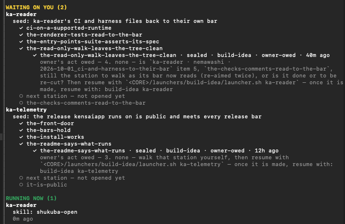
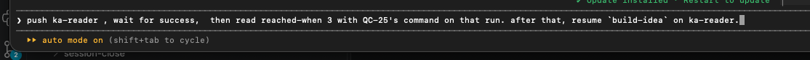
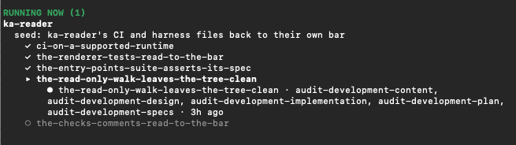
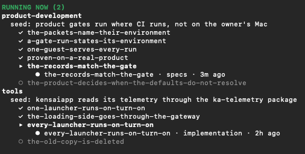
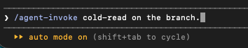
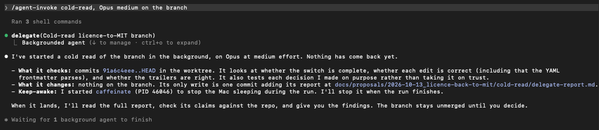
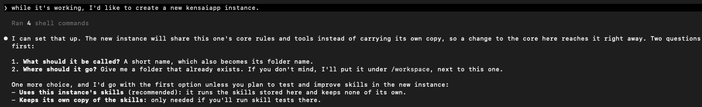
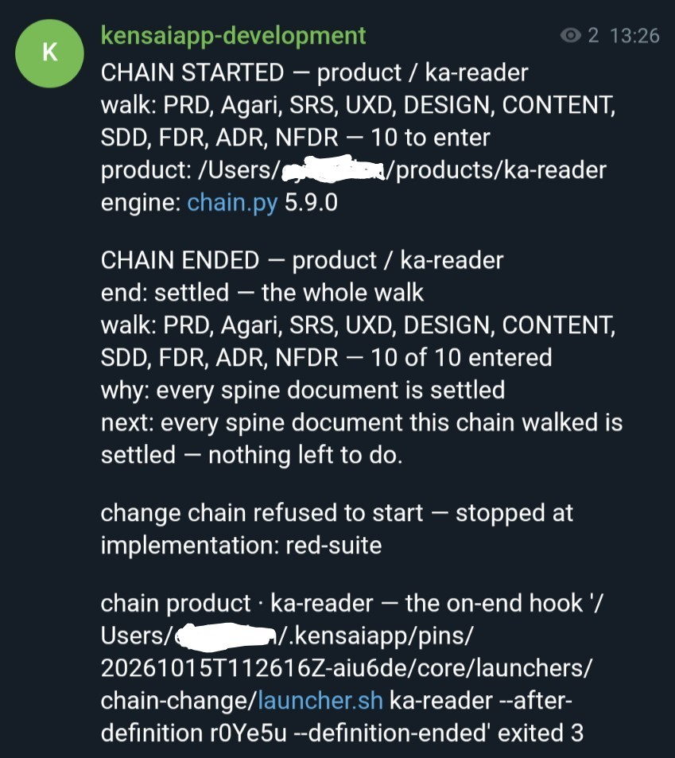
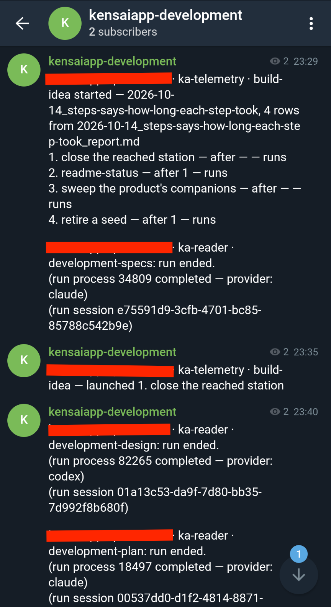
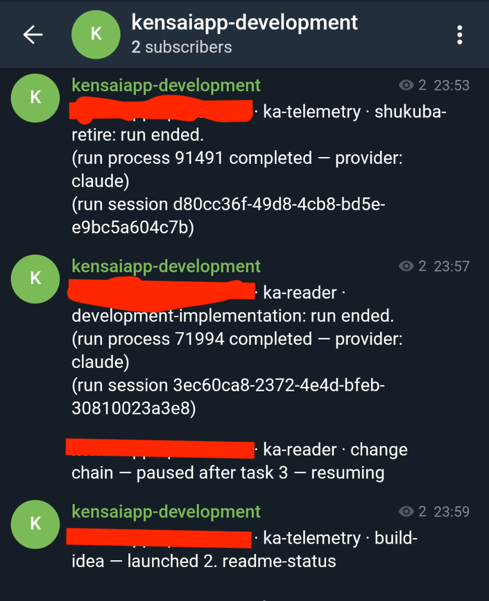

# Operations guide

This guide is the reference behind the [README](../README.md) on running KensaiApp: where things stand,
sessions, providers, launchers, more than one instance, findings and the additional features.

## See where things stand

`/kensaiapp-panel` opens a pane in your Claude Code session that lists the chains waiting on
you, and the ones running now ([step 5](../README.md#5-turn-on-the-panel) turns it on). For each project it shows
the seed being walked and the seed's route as a tree: the stations already reached, the one being
walked with its change, the step that change is on, how long it has been on it and, during the build,
which task of the plan it is on, and the stations not opened yet. A running walk shows how long it
has run in all; a waiting one, how long ago it started.

<p align="center"></p>
<p align="center"><sub>The pane from <code>/kensaiapp-panel</code>: one project waiting on its owner, one running, each with its route. A real session, 2026-10-21. ka-reader and ka-telemetry are two projects being built with KensaiApp.</sub></p>

When a chain is waiting on you, the pane says what it needs.

<p align="center"></p>
<p align="center"><sub>A real session, 2026-10-22.</sub></p>

You do the act it names, then tell the session in your own words. A reply to an earlier act owed:

<p align="center"></p>
<p align="center"><sub>From a real instance, 2026-10-14.</sub></p>

While a change is in review, the pane lists every audit running on it at once:

<p align="center"></p>
<p align="center"><sub>One change, five audits running at the same time. A real session, 2026-10-21.</sub></p>

KensaiApp is built the same way. The same pane, in the instance where KensaiApp itself is developed:

<p align="center"></p>
<p align="center"><sub>Two of KensaiApp's own projects walking at once; the second moved KensaiApp's telemetry onto ka-telemetry. A real session, 2026-10-21.</sub></p>

For the whole picture, `python3 core/tools/journey_status.py --repo .` writes one HTML page of the
instance's journey, with every place it has drifted from the model. It only reads.

### When a run stops, it says why

A chain's closing message names where it stopped and why. Most stops end the same way: you settle
the cause, then run the same launcher again. When you are not sure what a stop means, paste it to
Claude in your instance and ask. A shortened example, with the project renamed:

```text
> the chain in `my-app` is in halt. "owner's act owed: walk that station yourself, then resume
  with build-idea my-app". What and how do I walk that station myself?

  Your move: sort out the station in my-app. Either close it with the Scrum Master's
  `shukuba-retire my-app`, or find out why the queue thinks it is already closed. Then let a
  fresh refine and its queue run.
```

[Restarting a stopped walk](#restarting-a-stopped-walk) shows how to make that move yourself.

## Interactive sessions

Not all work goes through a launcher. Some you want to do with Claude directly, and some you hand
off and come back to: research, an investigation, a plan for a change, or a cold read of a branch by
an agent that did not write it.

### Loading skills and agents

KensaiApp uses progressive disclosure: a session sees only the skills and agents you give it. They
come in groups, one folder each under `skills/`. Give a group when you start Claude Code, where
`<host-path>` is the instance that holds the core:

```bash
claude --permission-mode acceptEdits --add-dir <host-path>/skills/interactive
```

Or during a session:

```text
/add-dir skills/interactive
```

The `interactive` group holds the skills meant for a session with you:

| Skill | What it does |
|---|---|
| `agent-invoke` | Hands work to an agent that runs in the background ([Delegating work](#delegating-work)) |
| `companion-answer` | Walks a document's open questions with you, one at a time, and writes your answers in |
| `session-close` | Moves what a session produced onto the files that keep it |
| `skill-creator` | Creates or changes a skill |
| `skill-evals-creator`, `skill-evals-trigger` | Write a skill's evals, and tune when it triggers |

The `experimental` group, `skills/experimental`, holds the skills that are still being tried out:

| Skill | What it does |
|---|---|
| `kaizen-audit` | Audits a pipeline skill through something it produced, with blind auditors |
| `skill-evals` | Runs a skill's evals |

### Asking a specific role

Start a message with a role's prefix, such as `pm:`, `cpo:`, `architect:`, `scrum-master:` or `ppm:`
for the Principal PM, and the session works as that role. A role's own skills sit in a group of its
own name, such as `skills/scrum-master`.

#### Restarting a stopped walk

Sometimes a walk stops on a move it leaves to you ([When a run stops](#when-a-run-stops-it-says-why)).
You make the move as the role that owns it, then start the queue again. For the example above:

```text
/add-dir skills/scrum-master
> scrum-master: run shukuba-retire for my-app
```

```bash
core/launchers/build-idea/launcher.sh my-app
```

### Delegating work

Delegation is part of the `interactive` group. With that group added, ask in plain words, such as
"get an agent to research this and report back", or name the skill, `/agent-invoke`. It starts the
work as an agent in the background of your session.

<p align="center"></p>
<p align="center"></p>
<p align="center"><sub>A real session.</sub></p>

The skill picks the model by where the judgment in the work lives: authoring or deciding takes a
top tier, applying a plan already decided takes the worker tier, and one mechanical change made many
times takes the cheap tier. It writes the agent a brief. The agent commits its own work and writes a
report of the run. When the agent ends, the session reads that report, checks it against the
repository and tells you what held.

### Planning a change by hand

`ad-hoc-plan` is the tech lead's plan for a change you open yourself, outside the journey's own
moves. It is work in progress. It needs the change opened first: one open change in the project,
with its change request committed. The PM's `tobiishi-open` writes one, or you can write it by hand.
The product can live inside the instance or in its own repository.

The plan starts from a brief, `ad_hoc_plan_brief.md` in the change's folder. In a session, the
session drafts it and puts it to you before anything else: your own words, and each file they rest
on, quoted. A quote that is not at its lines stops the plan. You confirm it, and it is committed on
`main` before the plan runs. Unattended, the change request is the brief.

```text
/add-dir skills/pm
> pm: tobiishi-open for my-app

/add-dir skills/tech-lead
> tech-lead: ad-hoc-plan for my-app
```

The skill opens the change's branch and working folder itself. It writes a short spec, a short design
and a full plan for the developer, commits them, and names the next command without running it.
Every run leaves `ad_hoc_plan_report.md` beside the brief: what it did with each line of what you
asked, and why it stopped if it did. The audit of such a change reviews its plan, content and code,
not the short spec and design:

```bash
core/launchers/chain-development/launcher.sh my-app
```

### Cutting seeds from an idea

`seeds-from-idea` does for one idea what `seeds-from-product-docs` does for a project's documents:
the Principal PM cuts it into seeds, each with its station checklist and a trace back to the idea,
in the project that owns it, or in the instance's own seedbed. It runs in a session, with no
launcher.

```text
/add-dir skills/principal-pm
> ppm: seeds-from-idea <the idea, in your own words>
```

The idea arrives as a brief. The session drafts it and puts it to you: your own words, and each file
they rest on, quoted. A quote that is not at its lines stops the cut. You confirm the brief, and it
is committed with the seeds, in the project's `docs/seeds-from-idea/`. Each seed quotes the part of
your words it carries.

A new seed waits to be picked. Pick one as the PM, then start the change chain, and the journey
walks itself from there:

```text
/add-dir skills/pm
> pm: nemawashi-pick my-app
```

```bash
core/launchers/chain-change/launcher.sh my-app
```

### How a session talks to you

Every session and every agent is given the same rules for replying to you, at its start: the answer
first, in one plain sentence; then why, in a few short numbered lines; everyday words; what happens
next; and the evidence last. Where a skill fixes the words of a message, those words win.

The rules live in one file, `core/doctrine/governance/talking_to_the_owner.md`, under its heading
"The rules". A hook copies that section word for word into every session and every agent when it
starts. To change how sessions reply to you, edit that section; the next session takes the change. In
a satellite, the file is the host's.

## Choosing a provider

`.providers.toml` names the provider for each document, each step and each kind of queue row. Without
a flag, and without `KENSAIAPP_AGENT_PROVIDER` exported, every launch reads the file as it stands, so an edit reaches the next step of a walk already
running.

`--provider claude|codex|gemini|hf|ollama` picks one provider for the whole walk instead. It is saved
with the walk and holds until the walk ends, including the queue `chain-change` starts at its end. If
you start `build-idea` again by hand, give the flag again: a start without it reads the file.

Exporting `KENSAIAPP_AGENT_PROVIDER` before a launch forces one provider as the flag does. These
launchers run on Claude only, whatever the flag or the variable says: `cold-read`, `launch-eval-fix`,
`launch-skill-evals`, `product-card`, `launch-apply-packet`, `launch-audit` and
`launch-fix-author`.

KensaiApp is tested and mostly run on Claude. The other providers can be part of the loops, with
gaps, the biggest in interactive mode.

## Using launchers

A launcher is a script you run outside a Claude Code session. Each starts its work as background
runs and returns, except `product-card`, which waits. You can also ask Claude in a session to run one for you, instead of loading a
role's group.

```bash
core/launchers/chain-change/launcher.sh <project>        # one change, ask to seal, then the next moves
core/launchers/build-idea/launcher.sh <project>          # a refine's next moves, as a queue
core/launchers/chain-product/launcher.sh <project>       # a project's product documents
core/launchers/chain-agari/launcher.sh <project>         # a project's PRD and definition of done
core/launchers/skill/launcher.sh <skill> [<argument>...] # any skill that has a launcher.md
core/launchers/cold-read/launcher.sh ...                 # blind cold reads over a skill's own stack
```

## More than one instance

A satellite is an instance that reads its host's core ([One mechanism, several
instances](architecture.md#one-mechanism-several-instances)). Satellites are work in progress: a script stands one
up, and no skill or launcher wraps it yet.

You can ask for one in a session, in plain words. It asks for the satellite's name, the folder to put it
in, and whether it keeps its own copy of the skills:

<p align="center"></p>
<p align="center"><sub>A real session.</sub></p>

Or run the script from the host:

```bash
python3 core/tools/spawn_satellite.py --name kensaiapp-<name> --location <parent-dir> --host <host-path> ...
```

`--help` lists the script's other options. The host keeps a list of its satellites, and you add the
new one to it by hand.

A satellite has no `core/` folder, so its launchers are reached through the host's. To launch from a
shell in a satellite, load the satellite's `.env` first. Its `CORE` line points at the host's core:

```bash
cd <satellite-path>
set -a; . ./.env; set +a
"$CORE/launchers/chain-change/launcher.sh" my-app
```

## Findings

Findings are where KensaiApp records the defects it finds in itself. The audit's findings about a
change are a different kind; [Two kinds of finding](how-it-works.md#two-kinds-of-finding) sets the two
side by side. The chains write them, and the
PM and the Principal PM work from them: the PM reads each change's audit findings when it refines the
station, and the Principal PM files the defects it finds when it refines the seedbed. Findings are
also how KensaiApp's own defects get fixed, by hand for now.

A finding is a defect in KensaiApp itself, such as in a skill, a prompt, a rule, a hook or a launcher,
noticed while doing something else. A small one is fixed in place, on the branch where it was
found. A larger one becomes a seed. One that is not fixed is written to
`docs/findings/<date>_<slug>.md`, in a commit of its own. A finding stays in the instance where it
was written; nothing carries it to the host.

In the pipeline, the audit step writes one findings file per step it reviews, as
[How a change moves](../README.md#how-a-change-moves) shows.

In a session, ask Claude to write a finding to `docs/findings/`. `/session-close` turns loose findings
from a session into a seed in the project that owns them.

In a satellite, a finding is written to the satellite's own `docs/findings/`, even when the defect is
in the host's core. Carrying it to the host is yours to do. This is work in progress, and nothing
moves findings between instances automatically.

## Additional features

### Each skill runs at its own model and effort

The work sets the intelligence, not the role that runs it. Two skills run by the same role may need
very different thinking: closing a change by procedure is not the same job as deciding what a
station becomes. So each skill declares the model and the effort it runs at, in one file per
provider beside its `SKILL.md`:

```
skills/<group>/.claude/skills/<skill>/intelligence/claude.md
  **Model:**  the exact model ID
  **Effort:** the effort level
  and the reason for both
```

The values in this release are considered defaults, not yet fully tuned. You can change
them by editing that file.

### Language packets

A language packet holds the engineering rules for one language: its toolchain, layout, quality
gates, conventions, errors and logging, testing, and where its gates run. There are packets for
JavaScript, Python, Rust, Shell, Swift and TypeScript. A change takes the languages its project's card
names; without them, the languages of the product's files. A language with no packet falls back on a
floor of rules that holds for any language.

Each packet also names the container image or virtual machine its gates run in, which
[Testing in isolation](#testing-in-isolation) describes. A code skeleton per language is what
`product-card` copies.

### Testing in isolation

A product's tests run where its continuous integration runs, not on whatever machine started the
walk. The developer's run, the senior engineer's proof, the security step and the seal each run the
product's test command in the environment the product's CI calls for, and each records which
environment that was:

| The product's CI runs on | Its tests run in |
|---|---|
| Linux | A Podman container, from the image the language's packet names |
| macOS, or the product holds Swift | A macOS virtual machine, under Tart |
| No CI | Your own Mac |

Where the CI runs a matrix, each version in it gets a container of its own. A matrix that mixes Linux
and macOS also runs its newest version once in the macOS virtual machine. Before the tests, each
environment installs the product's languages and dependencies; when that install fails, the walk
halts as `environment-not-ready`, before any test runs.

On a Mac, Podman runs its containers inside a virtual machine of its own, which `podman machine init`
creates once. A product's own decision files can override its language's default. To run a walk's
tests on your own Mac anyway, ask for it when you start the walk:

```bash
core/launchers/chain-change/launcher.sh my-app --gate-owners-mac
```

The ask is kept with the walk, so a resume keeps it. When the walk ends, it hands the ask to
`build-idea`, which puts it on every change walk it starts. Starting `build-idea` again by hand
without the flag drops the ask:

```bash
core/launchers/build-idea/launcher.sh my-app --gate-owners-mac
```

Only the tests run in a container or a virtual machine. The agents themselves run on your machine.

### Notifications

A run can message you through a program you name in `KENSAIAPP_NOTIFIER`: the full path of an
executable that takes the message as its one argument and exits 0 when it sent it. Set it in your
shell profile. With the variable unset, nothing is sent.

What sends a message:

- every chain launcher, when it starts and when it ends, with the reason it ended (`product-card`
  sends none);
- a delegated agent, when it finishes;
- a run started with `--keep-awake`, which needs a notifier set.

#### Telegram

KensaiApp does not ship a Telegram script; you write a short one:

1. Send `/newbot` to @BotFather and keep the token it gives you.
2. Send your bot a message, then read your chat's `id` from the bot's `getUpdates`.
3. Write a script that posts its argument to `https://api.telegram.org/bot<token>/sendMessage` with
   that `chat_id`, reads the token from your keychain or environment, and exits non-zero when
   Telegram rejects the message. A message is at most 4096 characters.
4. Make it executable and point `KENSAIAPP_NOTIFIER` at it.

The [how-to guide](how-to.md) has the details.

<p align="center">



</p>
<p align="center"><sub>Messages from a Telegram notifier, as runs start, pause and end. The instance's name is covered.</sub></p>

### Telemetry

Claude Code can export its usage as OpenTelemetry: tokens and cost per run, and each API request and
finished agent. KensaiApp's telemetry runs on [ka-telemetry](https://github.com/eyalgo/ka-telemetry),
an open-source package KensaiApp built: its receiver appends what it receives to files on your
machine, and removes every `user.email` attribute from what it receives before writing it.
The how-to guide's [How to collect telemetry](how-to.md#how-to-collect-telemetry) installs it and turns it on.

A launcher runs the package's command from `~/.kensaiapp/venv/bin/` and nowhere else. The command's
name is the one line of `.telemetry.env`, at the root of the instance whose core the launch runs on,
and an exported `KENSAIAPP_TELEMETRY_COMMAND` takes its place for one launch; set empty, it turns
telemetry off for that launch. The launcher finds the receiver through the file `--publish-endpoint`
writes. Without the package, or without that file, it starts its runs with no telemetry and says so
in one line.

A launcher exports a run's telemetry only to a receiver at a loopback address, and refuses any other
host. It tags each run with its provider, model and effort, so they can be read back afterwards from
what actually landed, not from what the launcher meant to send. The package's own commands read it
back per agent, per background run and per workflow step. Two scripts in `core/tools/` add what only
KensaiApp knows: `chain_usage.py` reads it per chain, and `run_provenance.py` reads one run's
provider, model and effort. They import the package, so they run under
`~/.kensaiapp/venv/bin/python`, as each says at its top.

Running the receiver as a background service on your machine is out of KensaiApp's scope.
