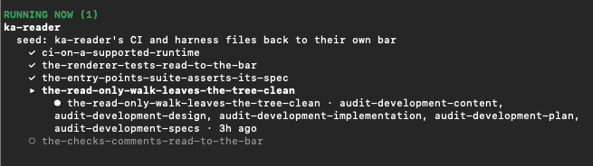

# Under the hood

How KensaiApp works, for software and AI engineers. The [README](../README.md) says what it does;
this page says how. Each section links to the guide that goes further.

## Why

Past the demo, the same things break.

| Agent coding, unmanaged | With KensaiApp |
|---|---|
| It said done. It wasn't. | A senior engineer proves the change against the spec, adds the tests nobody wrote, and fixes the code where a correct test fails. |
| It forgot what you decided. | The decision is a file: the PRD, the finish line, the spec, the design. Every run reads it fresh. |
| It drifted from what you wanted. | The PM's review after every change measures the route against the finish line, and re-cuts it. |
| One long session, one huge context. | Every step starts fresh, with only the files the step before left. |
| It stopped to ask, and waited all night. | A run never stops to ask while it writes. It leaves its questions in a file beside the document, and a later run answers them. |
| You review every line. | Only your calls reach you. The panel says what is waiting on you. |

## Everything is a file in git

Everything lives in git, on your machine. Nothing is hosted.

| Where | What |
|---|---|
| `core/` | The shared core: doctrine, launchers and tools, the same for every instance |
| `skills/<role>/` | Each role's skills. A session sees only the groups you add |
| `system/projects/<name>/` | Each project's card, finish line and journey |
| `products/<name>/` | The product, or a repository of its own |
| a change's trail | Its request, spec, design, plan, reports and findings, committed |

## A program sequences, models plan

**No model chooses what runs next.** Each step of a change is a separate agent run with its own
role. A program starts each step once the one before has left its result on disk, as
[The change](#the-change) shows.

**The plan is a table, and a program runs it.** After each change the PM's review writes the next
moves as a table. A program, `build-idea`, runs that table: each kind of row maps to one launcher in
the program's own table, a kind it does not know is refused, and a row's command is checked and
never run as written
([A plan written by a model, run by a program](agentic_description.md#a-plan-written-by-a-model-run-by-a-program)).

## The change

Every change passes through the same roles.

<p align="center"></p>

- **Ask.** The PM opens the change from the station it serves.
- **Spec, Design, Plan.** The product owner says what must hold, the architect where it goes, the tech
  lead how it is built, task by task.
- **Build.** The developer writes a failing test, then the code that passes it, then the refactor.
  A task that skips its failing test halts the walk.
- **Changelog.** The content editor writes the change's CHANGELOG entry, and takes off the product's
  list of what is left whatever the change wholly builds. It runs for every change. The diagram
  above does not show it yet.
- **Prove.** The senior engineer checks the code against the intent, not against itself.
- **Security.** It runs the product's dependency audit, reads the change for holes, fixes what its
  rules allow and reports the rest. A first iteration.
- **Audit.** The auditor reviews how well each step did its job. It does not stop the change. What
  it finds goes to the PM's review, which can re-cut the route, park a station or drop the change, and
  to the improvement of the skills themselves.
- **Seal.** The PM lands the change on `main`.

<sub>You decide what done means. The roles build it and check each other's work.</sub>

<details>
<summary>See it: one change, five audits at once</summary>
<br>
<p align="center"></p>
<sub>Each step of the change is audited by its own run, all at the same time. A real session, 2026-10-21.</sub>
</details>

## The walk

```bash
core/launchers/walk/launcher.sh <project>
```

- **Documents first.** It writes the product's documents as far as the project's card says, then
  opens a station and a change, carries the change through the pipeline to the seal, and runs the
  PM's review. The review's table then runs as a queue: close a station, retire a seed, pick the next
  one, or start the next change, which walks again
  ([From requirements to a product](architecture.md#from-requirements-to-a-product)).
- **An engine walks the documents along a spine.** The spine is the ordered list of documents a
  launcher hands the engine, upstream first. Each document goes through the same cycle: its writer
  runs, an answering run takes the questions it left open, and the writer runs again
  ([The journey launchers](architecture.md#the-journey-launchers)).
- **State lives on disk.** Nothing waits on a run. When one ends, its outcome goes to the engine,
  which reads where the walk is from a file and starts the next run. Given the same outcome twice, it
  moves once, so the same command run again carries on from what is on disk. `--stop` stops the runs
  in flight and keeps that state.
- **A pinned core.** A walk runs on a pinned copy of the shared core, so an edit made after the launch
  cannot reach a run in flight.

### Questions

A run that writes a document never stops to ask. It parks what it cannot settle in a companion file
beside the document. An answering run takes what it can and the writer runs again. What only you can
answer stays in the file, for you, and the walk stops only when it needs you.

## Each change, isolated

- **Its own worktree.** A change is built on a branch of its own, in a git worktree of its own, and
  reaches `main` only when the PM seals it. Before the worktree is made, every repository it will
  touch is checked ([Isolation](agentic_description.md#isolation)).
- **Tests first.** The developer builds each task in three commits: a failing test, the code that
  makes it pass, and a refactor where there is one. The refactor goes through three skills in turn,
  for clarity, for reuse and, where warranted, for performance. A test written to fail that passes at
  once is recorded as already passing, with a note, not forced to fail by breaking the code. A task
  in the test-first lane that landed with no failing-test commit before its code halts the walk; a
  task with no behaviour to test, such as a structural one, lands in one plain commit. The senior
  engineer's own tests are written from the spec, never read off the code.
- **Code goes where the design puts it.** A software product's design has a table of its parts and
  says which part owns what. The architect names the part that owns each piece of new logic, the tech
  lead puts it into that part's task, and the developer writes it there. The senior engineer moves any
  logic that landed elsewhere, in a commit of its own, before it proves the code, and the auditor
  marks what is still misplaced as `blocking`, for the PM's next review.
- **The product's tests run where its CI runs**, as the next section says.

### Where the tests run

A product's tests run where its continuous integration runs, not on whatever machine started the
walk. The developer's run, the senior engineer's proof, the security step and the seal each run the
product's test command in the environment the product's CI calls for, and each records which one:

| The product's CI runs on | Its tests run in |
|---|---|
| Linux | A Podman container, from the image the language's packet names |
| macOS, or the product holds Swift | A macOS virtual machine, under Tart |
| No CI | Your own Mac |

Where the CI runs a matrix, each version gets a container of its own. A matrix that mixes Linux and
macOS also runs its newest version once in the macOS virtual machine. Before the tests, each
environment installs the product's languages and dependencies; when that fails, the walk halts as
`environment-not-ready`, before any test runs. A product's own decision files can override its
language's default.

To run a walk's tests on your own Mac anyway, ask when you start it. The ask is kept with the walk,
and handed to every change `build-idea` starts after it; starting `build-idea` again by hand without
the flag drops it:

```bash
core/launchers/walk/launcher.sh my-app --gate-owners-mac
```

Only the tests run in a container or a virtual machine. The agents themselves run on your machine.

## Context

- **Each agent loads only what its work needs.** A role's agent is a short pointer to that role's
  rules, a session sees only the skill groups you give it, and the full rule files are read only when
  a task calls for them. Each step starts fresh, from the files the step before left
  ([Progressive disclosure](agentic_description.md#progressive-disclosure)).
- **A cap on the developer's context.** The developer's run can be long, and a run whose context
  keeps growing degrades. So it is capped, at 250,000 tokens by default, which the `walk` and
  `build-idea` launchers' `--context-cap` changes. Past the cap, a hook tells the run to finish the
  task it is on, commit, and end, and a fresh run carries on from the next task. What carries over is
  on disk: the plan and the commits. The cap reads the run's context size through ka-telemetry;
  without it installed, the run says it is not capped, and carries on.

### How a session talks to you

Every session and every agent is given the same rules for replying to you, at its start: the answer
first, in one plain sentence; then why, in a few short numbered lines; everyday words; what happens
next; and the evidence last. Where a skill fixes the words of a message, those words win.

The rules live in one file, `core/doctrine/governance/talking_to_the_owner.md`, under its heading
"The rules". A hook copies that section word for word into every session and every agent when it
starts. To change how sessions reply to you, edit that section; the next session takes the change. In
a satellite, the file is the host's.

## Rules held by code

Hooks, a commit check and the launchers hold what the model must not bend. Where an AI decision and
a mechanical rule conflict, the rule wins
([Rules the system enforces](architecture.md#rules-the-system-enforces)).

## Layers

KensaiApp's own parts are laid out as five layers, each with one job:

| Layer | What it holds | Its job |
|---|---|---|
| Brain | The roles' knowledge, the doctrine, and the model and effort each skill names | Decides |
| Hands | Skills and tools | Does the work it is given, without knowing who called it |
| Skeleton | The agent definitions, the pipeline's steps and the hand-off between them | Holds the shape |
| Muscles | The program that runs the steps, and the runs it starts | Moves the work through the shape |
| Reflexes | Hooks | Stop what breaks a rule, whatever the model reasoned |

Each layer depends only on the layers below it, and never names one above. All sequencing, which
step runs next, what runs in parallel, when to retry or stop, lives in the muscles. So a skill can be
run by a person, by a role in a session, or by the program, in the same way. Two parts of the
reflexes layer are not built yet: a hook that stops a run writing outside the files it was given, and
the lanes it would guard.

The rules the roles
follow are layered too: the shared core's, then the instance's, then a project's. A lower layer may
tighten a rule, never relax it.

## Models and providers

**Each skill runs at its own model and effort.** The work sets the intelligence, not the role that
runs it: closing a change by procedure is not the same job as deciding what a station becomes. Each
skill names its model and effort, and the reason for both, in one file per provider beside its
`SKILL.md`:

```
skills/<group>/.claude/skills/<skill>/intelligence/claude.md
```

The values in this release are defaults, not yet fully tuned. Edit the file to change them.

**A step can run on Claude, Codex, Gemini, Ollama or Hugging Face.** `.providers.toml` names the
provider for each document, each step and each kind of queue row, and every launch reads it as it
stands, so an edit reaches the next step of a walk already running. `--provider` picks one for the
whole walk instead: it is saved with the walk, and holds for the queue `walk` starts at its end. A
`build-idea` started again by hand needs the flag again. KensaiApp is tested and mostly run on
Claude. The other providers can be part of the loops, with gaps, the biggest in interactive mode.

## Languages

A language packet holds one language's engineering rules: toolchain, layout, quality gates,
conventions, errors and logging, testing, and where its gates run.

| Packets that ship |
|---|
| JavaScript · Python · Rust · Shell · Swift · TypeScript |

A change takes the languages its project's card names; without them, the languages of the product's
files. Each packet names the container image or virtual machine its gates run in, and its code
skeleton is what `product-card` copies. For another language, ask a KensaiApp session to write its
packet. The Rust one was written that way. Until then, a language with no packet falls back on rules
that hold for any language.

## Telemetry

Claude Code can export its usage as OpenTelemetry: tokens and cost per run, and each API request and
finished agent. KensaiApp's telemetry runs on [ka-telemetry](https://github.com/eyalgo/ka-telemetry),
an open-source package KensaiApp built. Its receiver appends what it receives to files on your
machine, and removes every `user.email` attribute before writing it. The how-to guide's
[How to collect telemetry](how-to.md#how-to-collect-telemetry) installs it.

A launcher exports a run's telemetry only to a receiver at a loopback address, and refuses any other
host. It tags each run with its provider, model and effort, so they are read back from what actually
landed, not from what the launcher meant to send. `core/tools/chain_usage.py` reads it per chain,
and `core/tools/run_provenance.py` one run's provider, model and effort. Without the package, a
launcher starts its runs with no telemetry and says so in one line.

## Satellites

A satellite is an instance with no core of its own: it reads its host's, so a change to the core
reaches every satellite as soon as it lands. KensaiApp's author runs one to make and keep his site,
[kensaiapp.ai](https://kensaiapp.ai), and its posts
([One mechanism, several instances](architecture.md#one-mechanism-several-instances)). How to stand
one up: the how-to's [How to create an instance](how-to.md#how-to-create-an-instance).

## Engineering

KensaiApp builds itself the same way it builds the products. Its own work is projects in its own
instance, walked by the same roles, through the same pipeline, sealed onto its own `main`.

- **Context.** Hooks set the start of every session and every agent, because an agent inherits no
  context from the one that started it: the path of the shared core, an index of which rule governs
  which task, and where each kind of file lives. Each index is read from its source when the hook
  runs, so it cannot drift. A fact has one owner, and every other file points at it
  ([Context engineering](agentic_description.md#context-engineering)).
- **Memory.** There is no vector store. What KensaiApp remembers between runs is files in git: the
  product's documents, the project's journey and the trail of every sealed change. How a session
  should conduct itself is kept apart, per instance, outside every repository, one file per rule
  ([Hand-off and memory](agentic_description.md#hand-off-and-memory)).
- **Findings.** A defect KensaiApp finds in itself, in a skill, a prompt, a rule, a hook or a
  launcher, is fixed in place when small, becomes a seed when larger, and is otherwise written to
  `docs/findings/`. The PM and the Principal PM work from them. A finding stays in the instance
  where it was written; carrying it to the host is yours to do, by hand for now
  ([Two kinds of finding](what-is-in-it.md#two-kinds-of-finding)).
- **Skills are versioned, and improved.** Every skill carries a version, and a commit can name the
  skill and version that produced it. The audit's findings, blind cold reads of a skill's own output and skill evals
  feed the skills' improvement. The evals and the kaizen audit are still experimental.
- **Its own tests.** The shared core carries its own test suite, run through uv on a locked Python
  and test tools.

### What it cost to build one product

ka-telemetry, a Python package on PyPI, was built end to end by KensaiApp's roles. From 2026-10-11
to 2026-10-24:

| Claude Code runs | Model requests | Total | One sealed change, typically |
|--:|--:|--:|--:|
| 590 | 13,315 | $680.52 | $18.82 |

By step, by model and effort, and by how large each run's context grew: its
[build cost report](https://github.com/eyalgo/ka-telemetry/blob/main/docs/build_cost.md). Every
figure is what Claude Code reported, from KensaiApp's own telemetry. With telemetry on, every run is
labelled with its instance, project, step, model and effort, so the cost can be read back by any of
them. The report counts launched Claude runs only; runs on other providers, and interactive
sessions, are not in it.
